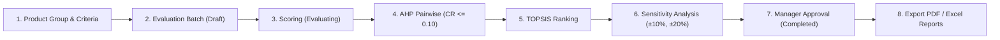

# Hệ Thống Hỗ Trợ Ra Quyết Định Lựa Chọn Nhà Cung Cấp (Supplier Selection DSS)

> **English Summary:** A robust, enterprise-grade Decision Support System (DSS) built with **ASP.NET Core 10 MVC**, **Entity Framework Core 10**, and **SQL Server**. The system implements the **Analytic Hierarchy Process (AHP)** to determine criteria weights and the **Technique for Order of Preference by Similarity to Ideal Solution (TOPSIS)** with Standard Competition Ranking ("1224") to rank suppliers. It includes academic **Sensitivity Analysis** ($\pm 10\%, \pm 20\%$ weight perturbation), secure report generation (**QuestPDF** & **ClosedXML**), defense-in-depth security, and a 100% verified independent algorithmic test suite.

---

## 1. Giới thiệu Dự án

Dự án là hệ thống hỗ trợ ra quyết định nội bộ (Decision Support System - DSS) phục vụ công tác mua sắm và quản lý chuỗi cung ứng của doanh nghiệp. Hệ thống giải quyết bài toán ra quyết định đa tiêu chí (MCDM - Multi-Criteria Decision Making) khi lựa chọn nhà cung cấp tối ưu giữa nhiều phương án cạnh tranh:

1. **Xác định trọng số tiêu chí (AHP):** Cho phép chuyên gia so sánh cặp giữa các tiêu chí theo thang điểm Saaty 1–9, tính toán trọng số bằng phương pháp trung bình nhân theo hàng (RGMM), và tự động kiểm tra tỷ số nhất quán $CR \le 0.10$.
2. **Xếp hạng nhà cung cấp (TOPSIS):** Chuẩn hóa ma trận đánh giá vector, tính khoảng cách hình học tới giải pháp lý tưởng dương ($PIS$) và âm ($NIS$), tính điểm tương đồng $CC_i$, và áp dụng xếp hạng chuẩn Standard Competition Ranking khi có trường hợp hòa điểm.
3. **Phân tích độ nhạy (Sensitivity Analysis):** Tính toán biến thiên trọng số $\pm 10\%, \pm 20\%$ để kiểm chứng độ vững bền của quyết định trước khi lãnh đạo phê duyệt.
4. **Báo cáo & Phê duyệt:** Quy trình phê duyệt minh bạch và hỗ trợ xuất báo cáo hoàn chỉnh dưới định dạng PDF (QuestPDF) và Excel (ClosedXML).

---

## 2. Công nghệ Sử dụng (Tech Stack)

- **Framework:** .NET 10 (`net10.0`), ASP.NET Core MVC (Razor Views).
- **Cơ sở dữ liệu:** SQL Server (Collation: `Vietnamese_CI_AS`), Entity Framework Core 10.
- **Xác thực & Bảo mật:** Cookie Authentication, mật khẩu băm BCrypt, chống User Enumeration & Timing Attack, Account Lockout 15 phút, bảo vệ chống Path Traversal cho tệp báo cáo, bộ lọc chống CSRF toàn cục, Security Response Headers.
- **Xuất dữ liệu:** QuestPDF (PDF Report) & ClosedXML (Excel Multi-sheet Workbook).
- **Hệ thống Giao diện:** Thiết kế Navy + Gold sang trọng, hỗ trợ Light/Dark mode (`wwwroot/css/tokens.css`).
- **Kiểm thử tự động:** xUnit, FluentAssertions 7.2.0 (Apache-2.0 License), EF Core InMemory, kèm bộ công cụ đối chiếu toán học độc lập bằng Python NumPy.

---

## 3. Sơ đồ Luồng Nghiệp vụ (Workflow Diagram)



---

## 4. Hướng dẫn Cài đặt từ Máy Trống (Clean Setup Guide)

### 4.1. Yêu cầu Tiên quyết
- **.NET 10 SDK** (phiên bản `10.0.100` trở lên). Kiểm tra bằng lệnh: `dotnet --version`.
- **Microsoft SQL Server** (2019, 2022 hoặc LocalDB).
- *(Tùy chọn cho đối chiếu toán học):* Python 3.10+ kèm thư viện `numpy`.

### 4.2. Khởi tạo Cơ sở Dữ liệu
Các tệp script SQL nguyên bản nằm trong thư mục `database/`:
1. Mở SQL Server Management Studio (SSMS), Azure Data Studio, hoặc chạy qua `sqlcmd`.
2. Thực thi tệp `database/01_schema.sql` để tạo cấu trúc 17 bảng, các khóa ngoại, 7 triggers kiểm soát trạng thái và 2 views thống kê.
3. Thực thi tệp `database/02_seed.sql` để nạp dữ liệu mẫu ban đầu (nhóm hàng, 8 tiêu chí chuẩn gồm cả Benefit và Cost, 5 nhà cung cấp mẫu, và 4 tài khoản người dùng ứng với 4 vai trò).

### 4.3. Cấu hình Chuỗi Kết nối (Connection String)
Để an toàn và không làm lộ mật khẩu, khuyến nghị cấu hình chuỗi kết nối qua **.NET User-Secrets** hoặc biến môi trường:

**Cách 1: Sử dụng .NET User-Secrets (Khuyến nghị cho môi trường phát triển)**
```bash
dotnet user-secrets set "ConnectionStrings:DefaultConnection" "Server=.;Database=SupplierSelectionDSS;Trusted_Connection=True;MultipleActiveResultSets=true;TrustServerCertificate=True"
```

**Cách 2: Sử dụng Biến môi trường**
```powershell
# PowerShell:
$env:ConnectionStrings__DefaultConnection="Server=.;Database=SupplierSelectionDSS;Trusted_Connection=True;MultipleActiveResultSets=true;TrustServerCertificate=True"
```

*(Hoặc điều chỉnh giá trị `DefaultConnection` trong tệp `appsettings.Development.json`).*

### 4.4. Chạy Ứng dụng
```bash
# Khôi phục gói và chạy dự án
dotnet run --project SupplierSelectionDSS.csproj
```
Ứng dụng sẽ khởi chạy tại: `https://localhost:7142` (hoặc cổng HTTP hiển thị trên màn hình console).

---

## 5. Danh sách Tài khoản Demo (Demo Accounts)

Cơ sở dữ liệu mẫu đi kèm 4 tài khoản đã băm BCrypt an toàn:

| Tên đăng nhập | Mật khẩu mặc định | Vai trò (Role) | Chức năng chính |
| :--- | :--- | :--- | :--- |
| **`admin`** | `Admin@123456` | **Administrator** | Quản trị hệ thống, tài khoản, xem Audit Log |
| **`staff01`** | `Staff@123456` | **PurchasingStaff** | Quản lý NCC, tiêu chí, tạo đợt đánh giá, nhập điểm |
| **`expert01`** | `Expert@123456` | **Expert** | Chuyên gia lập ma trận so sánh cặp AHP |
| **`mgr01`** | `Manager@123456` | **Manager** | Lãnh đạo xem độ nhạy, phê duyệt kết quả cuối cùng |

> ⚠️ **Lưu ý bảo mật:** Khi triển khai trên môi trường thật, vui lòng đăng nhập tài khoản Quản trị viên để đổi mật khẩu và cập nhật thông tin người dùng.

---

## 6. Hướng dẫn Chạy Kiểm thử (Automated Tests & Math Verification)

### 6.1. Chạy Bộ Kiểm thử .NET (123 Tests)
Toàn bộ thuật toán AHP, TOPSIS, Phân tích độ nhạy, Bảo mật tệp báo cáo, Khóa tài khoản và Logic quản trị viên đều được kiểm thử tự động:
```bash
# Chạy toàn bộ 123 unit/integration tests
dotnet test

# Chạy kèm thu thập độ bao phủ mã (Code Coverage)
dotnet test --collect:"XPlat Code Coverage"
```

### 6.2. Kiểm chứng Toán học Độc lập bằng Python (NumPy)
Hệ thống cung cấp một script kiểm chứng độc lập nằm tại `tools/verify/verify_mcdm.py`. Script này sử dụng hàm tính vector riêng chính xác (`numpy.linalg.eig`) và công thức vector TOPSIS viết độc lập để đối chiếu chéo với kết quả của C#:
```bash
# Chạy với uv (hoặc python thông thường)
uv run tools/verify/verify_mcdm.py
```
Kết quả cho thấy sai số giữa C# và NumPy nhỏ hơn $10^{-6}$ (chính xác tuyệt đối).

---

## 7. Cấu trúc Thư mục Dự án

```text
SupplierSelectionDSS/
├── .github/workflows/          # CI Pipeline tự động (.NET 10 Build & Test)
├── Constants/                  # Các hằng số chuẩn hóa (UserRole, BatchStatus, CriteriaType...)
├── Controllers/                # Controllers điều hướng và kiểm soát quyền hạn
├── Data/                       # ApplicationDbContext và các thực thể Scaffold
├── Infrastructure/             # Xuất báo cáo ngoài luồng (QuestPDF, ClosedXML)
├── Models/                     # ViewModels cho Razor Views và API
├── Services/                   # Nghiệp vụ lõi và thuật toán AHP, TOPSIS, Sensitivity
├── Views/                      # Giao diện người dùng Razor Views (Navy + Gold)
├── database/                   # Script khởi tạo cơ sở dữ liệu (01_schema.sql, 02_seed.sql)
├── docs/                       # Tài liệu học thuật phục vụ bảo vệ đồ án
│   ├── ALGORITHMS.md           # Cơ sở toán học AHP, TOPSIS & Phân tích độ nhạy
│   ├── ARCHITECTURE.md         # Kiến trúc hệ thống, vòng đời Batch, bảo mật & RBAC
│   └── AUDIT.md                # Báo cáo đánh giá độc lập toàn diện và trạng thái xử lý
├── tools/verify/               # Công cụ Python đối chiếu kết quả toán học với NumPy
├── wwwroot/                    # Tệp tĩnh (CSS, JS, Fonts, Icons)
├── SupplierSelectionDSS.Tests/ # Dự án kiểm thử nội bộ xUnit (123 tests)
└── App_Data/reports/           # Thư mục lưu trữ báo cáo cách ly ngoài webroot
```

---

## 8. Tài liệu Phục vụ Bảo vệ Đồ án (Academic Defense Docs)

Để bảo vệ đồ án trước hội đồng học thuật, hãy tham khảo các tài liệu chuyên sâu được chuẩn bị trong thư mục `docs/`:
- **[ALGORITHMS.md](file:///D:/DEAN/Projects/SupplierSelectionDSS/docs/ALGORITHMS.md):** Diễn giải tường minh từng công thức toán học, bảng ngẫu nhiên Saaty $RI$, phương pháp chuẩn hóa vector, xếp hạng 1224 và bài toán mẫu từng bước.
- **[ARCHITECTURE.md](file:///D:/DEAN/Projects/SupplierSelectionDSS/docs/ARCHITECTURE.md):** Sơ đồ thành phần, máy trạng thái hữu hạn của đợt đánh giá, kiến trúc bảo mật chống tấn công leo quyền và mô hình cơ sở dữ liệu.
- **[AUDIT.md](file:///D:/DEAN/Projects/SupplierSelectionDSS/docs/AUDIT.md):** Báo cáo rà soát độc lập từng dòng lệnh và ma trận đối chiếu mức độ an toàn của hệ thống.

---

## 9. Giấy phép Mã nguồn (License)

Dự án được phân phối dưới giấy phép **[MIT License](file:///D:/DEAN/Projects/SupplierSelectionDSS/LICENSE)**.
