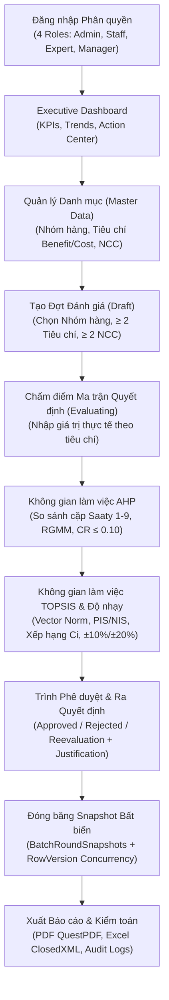
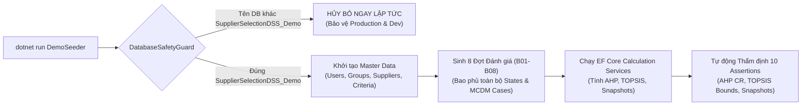
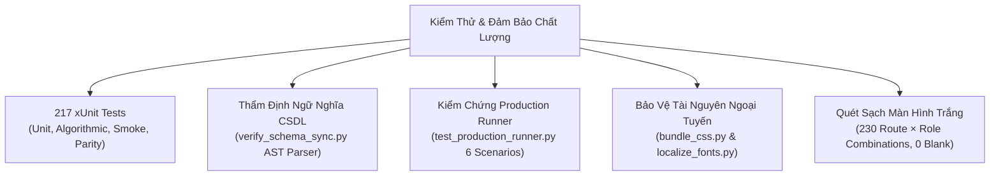

# Supplier Selection Decision Support System

[](https://github.com/daongochan/Supplier_Selection_Decision_Support_System/actions/workflows/ci.yml)
[](https://dotnet.microsoft.com/)
[](https://learn.microsoft.com/dotnet/csharp/)
[](https://www.microsoft.com/sql-server/)
[](https://learn.microsoft.com/ef/core/)
[](https://github.com/daongochan/Supplier_Selection_Decision_Support_System/actions)
[](LICENSE)

> **English Summary:** An enterprise-grade Decision Support System (DSS) engineered with **ASP.NET Core 10 MVC**, **Entity Framework Core 10**, and **Microsoft SQL Server**. The system implements the **Analytic Hierarchy Process (AHP)** to calculate criteria weights via the Row Geometric Mean Method (RGMM) with strict consistency checking ($CR \le 0.10$), and the **Technique for Order of Preference by Similarity to Ideal Solution (TOPSIS)** with Standard Competition Ranking ("1224") to rank competing suppliers. It incorporates academic **Sensitivity Analysis** ($\pm 10\%, \pm 20\%$ weight perturbation), immutable evaluation round snapshots, multi-format secure reporting (**QuestPDF** & **ClosedXML**), defense-in-depth security, a modern executive English UI with collapsible sidebar and glassmorphic authentication, a complete **Reproducible Demonstration Dataset Suite** with dedicated safety guards, and a 100% verified test suite of **217 automated tests**.

---

## 1. Giới Thiệu Dự Án

**Supplier Selection Decision Support System** là giải pháp phần mềm hỗ trợ ra quyết định nội bộ phục vụ công tác mua sắm tập trung, thẩm định nhà thầu và quản lý chuỗi cung ứng trong doanh nghiệp. Hệ thống giải quyết trọn vẹn bài toán ra quyết định đa tiêu chí (MCDM - Multi-Criteria Decision Making) khi lựa chọn nhà cung cấp tối ưu giữa các phương án cạnh tranh:

1. **Xác định trọng số tiêu chí (AHP):** Chuyên gia thực hiện so sánh cặp theo thang đo Saaty 17 mức giá trị (`1/9` đến `9`). Trọng số được tính toán tự động bằng phương pháp trung bình nhân theo hàng (RGMM - Row Geometric Mean Method) kèm kiểm tra tính nhất quán ($CR \le 0.10$). Hệ thống bảo đảm tính đối xứng nghịch đảo tuyệt đối ($a_{ji} = 1/a_{ij}$), hiển thị giải thích ngôn ngữ tự nhiên tức thì.
2. **Xếp hạng nhà cung cấp (TOPSIS):** Chuẩn hóa vector ma trận điểm số, xác định giải pháp lý tưởng dương ($A^+ / PIS$) và âm ($A^- / NIS$) phân biệt chuẩn xác theo hướng tiêu chí Lợi ích (Benefit - càng lớn càng tốt) và Chi phí (Cost - càng nhỏ càng tốt), tính khoảng cách Euclid đa chiều ($S^+, S^-$), xác định hệ số gần gũi tương đối ($C_i$), và xếp hạng nhà cung cấp theo chuẩn Standard Competition Ranking ("1224") khi có đồng hạng.
3. **Phân tích độ nhạy (Sensitivity Analysis):** Khảo sát biến thiên trọng số từng tiêu chí ở các biên độ $\pm 10\%$ và $\pm 20\%$, tự động tái chuẩn hóa tổng trọng số bằng 1, đánh giá độ ổn định của nhà cung cấp dẫn đầu và cảnh báo các kịch bản đảo chiều thứ hạng (Rank Inversion).
4. **Phê duyệt phân quyền & Snapshot bất biến:** Quy trình phê duyệt minh bạch yêu cầu nhập lý do giải trình khi chọn nhà cung cấp không xếp hạng 1. Mỗi quyết định phê duyệt đều tự động đóng băng dữ liệu vòng đánh giá (Immutable Round Snapshots) và kiểm soát tương tranh lạc quan (Optimistic Concurrency Control qua `RowVersion`).
5. **Báo cáo chuyên nghiệp đa định dạng:** Tự động kết xuất hồ sơ quyết định phân trang định dạng **PDF** (chuẩn QuestPDF) và bảng tính thẩm định đa trang **Excel** (chuẩn ClosedXML), lưu trữ cách ly an toàn tại `App_Data/reports/`.
6. **Bộ dữ liệu demo tái lập (Demo Dataset Suite):** Trang bị bộ sinh dữ liệu và thẩm định độc lập (`tools/demo/DemoSeeder`) với chốt an toàn nghiêm ngặt (`DatabaseSafetyGuard`), cung cấp 8 đợt đánh giá thực tế bao phủ 100% trạng thái vòng đời và các ca biên MCDM.

---

## 2. Tính Năng & Phân Hệ Trọng Tâm



### 2.1. Bảng điều khiển Quản trị (Executive Dashboard)
- Hiển thị hệ thống thẻ chỉ số KPI thời gian thực: Tổng số đợt đánh giá, Tổng NCC tham gia, Số đợt hoàn thành và Đợt đang chờ xử lý.
- Biểu đồ xu hướng tham gia của nhà cung cấp qua các tháng và biểu đồ cơ cấu trạng thái đợt đánh giá.
- Hộp thông báo thông minh định tuyến theo vai trò, liên kết trực tiếp tới các tác vụ cần thực hiện.

### 2.2. Quản lý Danh mục (Master Data Management)
- **Nhóm hàng (Product Groups):** Phân loại ngành hàng mua sắm (CNTT, Thiết bị phần cứng, Văn phòng phẩm, Bao bì, Dịch vụ...).
- **Nhà cung cấp (Suppliers):** Quản lý hồ sơ doanh nghiệp, mã số thuế, thông tin liên hệ và giao diện liên kết nhóm hàng dạng thẻ trực quan (card grid) có bộ lọc tìm kiếm tức thì.
- **Tiêu chí đánh giá (Criteria):** Cấu hình linh hoạt loại tiêu chí (`Benefit` - Lợi ích, `Cost` - Chi phí) và đơn vị đo lường (Điểm 1-100, VNĐ, Ngày, Tỷ lệ %).

### 2.3. Quy trình Vòng đời Đợt đánh giá (Batch Lifecycle FSM)
- `Draft`: Khởi tạo phạm vi đánh giá, chỉ định nhóm hàng, chọn tối thiểu 2 nhà cung cấp và 2 tiêu chí.
- `Evaluating`: Khóa cấu hình phạm vi; mở quyền nhập bảng điểm ma trận và thực hiện tính toán MCDM.
- `Completed`: Đóng băng dữ liệu sau khi được cấp quản lý phê duyệt; các trigger SQL Server và lớp service ngăn chặn tuyệt đối mọi hành vi sửa đổi điểm hoặc cấu hình.
- `Cancelled`: Đợt đánh giá bị hủy bỏ và lưu vết kiểm toán, khóa vĩnh viễn quyền chỉnh sửa.

### 2.4. Không gian làm việc AHP (AHP Workspace)
- **Thang đo Saaty 17 mức:** Hỗ trợ đầy đủ thang đo Saaty từ `1/9` đến `9` qua danh sách chọn (dropdown) trực quan, tự động phản ánh mô tả ngôn ngữ tự nhiên của từng cặp tiêu chí.
- **Tính đối xứng nghịch đảo tuyệt đối:** Nhập giá trị ô $a_{ij}$ lập tức tự động điền ô đối xứng $a_{ji} = 1/a_{ij}$; đường chéo chính cố định bằng $1.0$.
- **Kiểm tra tính nhất quán tự động:** Tính toán vector trọng số bằng phương pháp trung bình nhân theo hàng (RGMM), xác định $\lambda_{\max}$, chỉ số nhất quán $CI$ và tỷ số nhất quán $CR = CI / RI$. Cảnh báo trực quan nổi bật khi ma trận mâu thuẫn ($CR > 0.10$).
- **Độ chính xác lưu trữ:** Cột CSDL sử dụng `DECIMAL(10,4)`, lưu trữ chính xác các giá trị phân số Saaty tiêu chuẩn (`0.3333`, `0.1111`...). Dung sai kiểm tra nghịch đảo ở tầng dịch vụ được ghim ở mức $0.01$ để tương thích hoàn hảo giữa số học phân số và kiểu dữ liệu thập phân.

### 2.5. Không gian làm việc TOPSIS & Phân tích Độ nhạy
- **Chuẩn hóa vector:** Biến đổi điểm số thô thành ma trận chuẩn hóa vector $r_{ij} = x_{ij} / \sqrt{\sum x_{ij}^2}$.
- **Nhân trọng số & Nghiệm lý tưởng:** Nhân ma trận chuẩn hóa với vector trọng số AHP ($v_{ij} = w_j \times r_{ij}$); tự động xác định $A^+$ (giá trị lớn nhất với tiêu chí Benefit, nhỏ nhất với Cost) và $A^-$ (ngược lại).
- **Khoảng cách Euclid & Hệ số gần gũi:** Đo lường khoảng cách đa chiều $S_i^+$ và $S_i^-$, tính hệ số gần gũi $C_i = S_i^- / (S_i^+ + S_i^-) \in [0, 1]$.
- **Xếp hạng Standard Competition Ranking:** Xếp hạng nhà cung cấp theo thứ tự giảm dần của $C_i$, xử lý đồng hạng theo chuẩn "1224".
- **Phân tích độ nhạy (Sensitivity Analysis):** Mô phỏng biến thiên trọng số từng tiêu chí ở các mức $\pm 10\%$ và $\pm 20\%$, tự động bù trừ tỷ lệ các tiêu chí còn lại để tổng trọng số luôn bằng $1.0$, phát hiện và làm nổi bật các trường hợp đảo chiều thứ hạng.

### 2.6. Phê duyệt, Snapshot & Kiểm soát Tương tranh
- **Quy trình phê duyệt 3 hướng:** Quản lý có thẩm quyền ra quyết định Phê duyệt (`Approved`), Từ chối (`Rejected`), hoặc Yêu cầu đánh giá lại (`Reevaluation`).
- **Giải trình bắt buộc (Justification):** Bắt buộc nhập lý do giải trình chi tiết khi quản lý phê duyệt nhà cung cấp không nằm ở vị trí xếp hạng 1.
- **Snapshot vòng đánh giá bất biến:** Lưu trữ toàn bộ kết quả xếp hạng, điểm số và trọng số tại thời điểm ra quyết định vào bảng `BatchRoundSnapshots`.
- **Optimistic Concurrency Control:** Bổ sung cột `RowVersion` (`rowversion`/`timestamp`) trên bảng `EvaluationBatches`, phát hiện và ngăn chặn xung đột ghi đè khi nhiều người dùng cùng thao tác.

### 2.7. Báo cáo & Kiểm toán An toàn
- **Báo cáo PDF (QuestPDF):** Báo cáo hồ sơ phê duyệt chính thức được trình bày chuẩn mực, phân trang tự động, có chữ ký và bảng biểu rõ ràng.
- **Báo cáo Excel (ClosedXML):** Bảng tính `.xlsx` đa sheet chứa đầy đủ ma trận quyết định thô, ma trận chuẩn hóa, trọng số AHP, bảng tính khoảng cách và kết quả độ nhạy.
- **Lưu trữ cách ly an toàn:** Báo cáo sinh trong runtime được lưu tại `App_Data/reports/`. Middleware ứng dụng chặn toàn bộ truy vấn trực tiếp từ webroot tới `/reports/*`, chỉ cho phép tải về thông qua Controller có kiểm tra quyền hạn.
- **Audit Logging an toàn:** Tự động ghi vết mọi thao tác nhạy cảm kèm mã `TraceIdentifier`. Dịch vụ tự động làm mờ (masking) các thông tin nhạy cảm như mật khẩu và token.

### 2.8. Giao diện Doanh nghiệp Hiện đại (Executive Modern UI/UX)
- **Chuẩn hóa ngôn ngữ tiếng Anh nhất quán:** Toàn bộ giao diện người dùng (tiêu đề trang, thanh điều hướng, bảng biểu, form nhập liệu, nhãn trạng thái, hộp thoại xác nhận và thông báo lỗi) được đồng bộ bằng tiếng Anh doanh nghiệp chuẩn.
- **Màn hình Đăng nhập Tinh tế:** Thiết kế thẻ kính mờ (glassmorphism frosted glass) trên nền phong cảnh nghệ thuật tối ưu (`login-bg.webp`), tích hợp nút ẩn/hiện mật khẩu tiện dụng.
- **Thanh Điều Hướng Thu Gọn (Collapsible Sidebar):** Thanh sidebar hỗ trợ thu gọn/mở rộng linh hoạt, lưu trạng thái vào `localStorage`, tích hợp logo thương hiệu Duck (`duck-logo.svg`) và nút mở rộng tự động hiển thị khi hover.
- **Hệ thống Design Tokens CSS3:** Quản lý tập trung biến CSS (`tokens.css`), hỗ trợ chế độ Dark Theme độ tương phản cao, số liệu căn chỉnh chuẩn với `font-variant-numeric: tabular-nums`.

---

## 3. Bộ Dữ Liệu Trình Diễn Tái Lập (Reproducible Demo Dataset Suite)

Nhằm phục vụ báo cáo thuyết trình, thẩm định chức năng và kiểm thử tự động, hệ thống tích hợp công cụ dòng lệnh chuyên dụng **DemoSeeder** (`tools/demo/DemoSeeder/`):



### 3.1. Chốt An toàn Cách ly Cơ sở Dữ liệu (DatabaseSafetyGuard)
> [!IMPORTANT]
> - **Chỉ cho phép thực thi trên:** `SupplierSelectionDSS_Demo`.
> - **Chốt an toàn tự động:** Bộ seeder và các script kiểm tra sẽ **dừng thực thi ngay lập tức** nếu phát hiện chuỗi kết nối trỏ tới database nghiệp vụ chính (`SupplierSelectionDSS`), database đo lường benchmark (`SupplierSelectionDSS_Perf`), hoặc các database hệ thống (`master`, `model`, `msdb`, `tempdb`).
> - **Tính toàn vẹn thuật toán:** Dữ liệu seed được xử lý trực tiếp qua các service nghiệp vụ chuẩn của ứng dụng (`AHPCalculationService`, `TOPSISCalculationService`), đảm bảo tuân thủ 100% ràng buộc CSDL và triggers nghiệp vụ.

### 3.2. Danh mục 8 Đợt Đánh giá Trình diễn (B01 - B08)

| Mã đợt | Tên đợt đánh giá | Nhóm hàng | Trạng thái | Điểm nhấn kỹ thuật & MCDM |
|---|---|---|---|---|
| **B01** | Q1 Enterprise Laptop Procurement | Laptops & Workstations | `Completed` (Approved) | Kịch bản lý tưởng: AHP $CR = 0.0402 \le 0.10$; NCC xếp hạng 1 vượt trội rõ rệt. |
| **B02** | High-Density Datacenter Server Fleet | Datacenter Hardware | `Completed` (Approved) | **Đảo chiều thứ hạng:** Khi tăng trọng số Chi phí $+20\%$, NCC xếp hạng 2 vươn lên dẫn đầu. |
| **B03** | Core Networking Switch Infrastructure | Networking Equipment | `Completed` (Rejected) | Quản lý **Từ chối phê duyệt** do giá chào vượt định mức ngân sách năm. |
| **B04** | Industrial Corrugated Packaging Supply | Packaging Materials | `Completed` (Reevaluation) | Quản lý **Yêu cầu đánh giá lại** để thẩm định thêm rủi ro gián đoạn giao hàng. |
| **B05** | Multi-Region Cloud Hosting & CDN | Cloud Infrastructure | `Evaluating` | Đợt đang đánh giá: Bảng điểm đã nhập đầy đủ, chờ chuyên gia hoàn thiện ma trận AHP. |
| **B06** | Facilities Maintenance & Janitorial Services | Office Services | `Draft` | Đợt sơ bộ: Đang cấu hình phạm vi danh mục tiêu chí và nhà cung cấp. |
| **B07** | Surveillance & Biometric Access Systems | Security Equipment | `Completed` (Approved) | Biên độ cạnh tranh sát nút: Điểm $C_i$ giữa hạng 1 và 2 chênh lệch chỉ $0.008$. |
| **B08** | Annual Office Stationery & Consumables | Office Supplies | `Cancelled` | Đợt bị hủy bỏ do thay đổi kế hoạch phân bổ ngân sách nội bộ. |

### 3.3. Các lệnh Thao tác Demo Dataset

**1. Nạp toàn bộ dữ liệu demo (tự động chạy kèm bộ thẩm định sau khi nạp):**
```powershell
dotnet run --project tools/demo/DemoSeeder/DemoSeeder.csproj -- --seed
```

**2. Chạy thử nghiệm mô phỏng không ghi vào CSDL (Dry-Run):**
```powershell
dotnet run --project tools/demo/DemoSeeder/DemoSeeder.csproj -- --seed --dry-run
```

**3. Chạy bộ thẩm định kiểm tra tính toàn vẹn trên database demo hiện hữu:**
```powershell
dotnet run --project tools/demo/DemoSeeder/DemoSeeder.csproj -- --verify
```

**4. Neo mốc thời gian đánh giá theo ngày tùy chọn:**
```powershell
dotnet run --project tools/demo/DemoSeeder/DemoSeeder.csproj -- --seed --as-of-date 2026-10-26
```

**5. Chạy script thẩm định độc lập bằng SQLCMD:**
```powershell
sqlcmd -S . -E -C -d SupplierSelectionDSS_Demo -i tools/demo/verify_demo.sql
```

> [!TIP]
> Chi tiết hướng dẫn trình diễn theo kịch bản 7 màn thuyết trình (7-act walkthrough) xem tại [docs/DEMO_GUIDE.md](docs/DEMO_GUIDE.md).

---

## 4. Công Nghệ & Thư Viện Sử Dụng

| Thành phần | Công nghệ / Gói NuGet | Phiên bản | Trách nhiệm chính trong hệ thống |
|---|---|---|---|
| **Web Framework** | ASP.NET Core MVC | .NET 10 (`net10.0`) | Kiến trúc MVC, Razor Views, Action Filters, Model Binding |
| **Data Access & ORM** | Entity Framework Core | 10.0.11 | Quản lý thực thể, DbContext, LINQ queries, Concurrency check |
| **Cơ sở dữ liệu** | Microsoft SQL Server | 2019 trở lên | 18 bảng, 7 triggers, 2 views, 21 indexes, Collation Vietnamese |
| **Bảo mật & Mã hóa** | Cookie Auth + BCrypt.Net-Next | 4.2.0 | Quản lý phiên đăng nhập an toàn, băm mật khẩu chuẩn cost 11 |
| **Bảo mật Phụ thuộc** | System.Security.Cryptography.Pkcs | 9.0.21 | Ghim phiên bản bảo mật giải quyết triệt để CVE lỗ hổng bắc cầu |
| **Báo cáo PDF** | QuestPDF | 2026.7.3 | Thiết kế và kết xuất báo cáo phân trang chuẩn mực doanh nghiệp |
| **Báo cáo Excel** | ClosedXML | 0.105.1 | Sinh bảng tính thẩm định và phân tích độ nhạy dạng `.xlsx` |
| **Asset Pipeline** | Python 3 Bundler & Localizer | 3.x | Đóng gói CSS và bản địa hóa font ngoại tuyến với SHA-256 manifest |
| **Kiểm thử Tự động** | xUnit, FluentAssertions, Moq | 2.9.3 / 7.2.0 | Bộ kiểm thử đơn vị, kiểm thử tích hợp và thuật toán (217 tests) |

---

## 5. Hướng Dẫn Cài Đặt & Môi Trường Phát Triển

### 5.1. Yêu cầu Hệ thống (Prerequisites)
- **.NET SDK 10.0** (hỗ trợ `net10.0`).
- **Microsoft SQL Server** (Bản Developer, Standard, Express hoặc LocalDB) kèm tiện ích `sqlcmd`.
- **Python 3** (dùng cho các công cụ xác minh schema và đóng gói assets ngoại tuyến).
- **Git**.

### 5.2. Clone Repository & Restore Dependencies
```bash
git clone https://github.com/daongochan/Supplier_Selection_Decision_Support_System.git
cd Supplier_Selection_Decision_Support_System
dotnet restore SupplierSelectionDSS.slnx
```

---

### 5.3. Khởi tạo Cơ sở Dữ liệu

Hệ thống hỗ trợ 3 quy trình khởi tạo cơ sở dữ liệu tùy theo mục đích sử dụng:

#### Cách A: Khởi tạo Môi trường Phát triển (Development with Seed)
Chỉ thực hiện trên SQL Server chưa có database `SupplierSelectionDSS`. Script được trang bị chốt an toàn chống xóa nhầm:
```powershell
# Bước 1: Tạo cấu trúc Schema (18 bảng, 7 triggers, 2 views, 21 indexes)
sqlcmd -S . -E -C -b -v ConfirmRecreate=NO -i database/01_schema.sql

# Bước 2: Nạp dữ liệu seed phát triển duy nhất (mật khẩu băm BCrypt cost 11)
sqlcmd -S . -E -C -b -i database/02_seed.sql
```

#### Cách B: Khởi tạo Môi trường Production Sạch (Fresh Production Provisioning)
Runner `database/scripts/Run_Production.sql` thực hiện quy trình tự động 10 bước độc lập, tuyệt đối **không chứa tài khoản mẫu hay dữ liệu phát triển**:
```bash
cd database/scripts
sqlcmd -S . -E -C -b -v DatabaseName=SupplierSelectionDSS -i Run_Production.sql
```
- Tự động từ chối nếu database đã tồn tại để tránh ghi đè dữ liệu.
- Bước cuối (`10_Verify_Database.sql`) xác minh đủ 18 bảng, 7 triggers, 2 views, 21 user indexes (`is_ms_shipped = 0`) và đúng 0 tài khoản demo.

#### Cách C: Khởi tạo Môi trường Trình diễn Demo (Demo Provisioning)
Tạo database demo riêng biệt và nạp 8 đợt đánh giá đa dạng:
```powershell
# Bước 1: Tạo cấu trúc CSDL đích SupplierSelectionDSS_Demo
cd database/scripts
sqlcmd -S . -E -C -b -v DatabaseName=SupplierSelectionDSS_Demo -i Run_Production.sql
cd ../..

# Bước 2: Chạy công cụ DemoSeeder để nạp dữ liệu và kiểm tra
dotnet run --project tools/demo/DemoSeeder/DemoSeeder.csproj -- --seed
```

> [!NOTE]
> **Nâng cấp CSDL đang vận hành:** Nếu CSDL đang có dữ liệu nghiệp vụ, không chạy script tạo mới mà áp dụng tuần tự các bản vá trong thư mục `database/patches/` theo hướng dẫn tại [database/README.md](database/README.md).

---

### 5.4. Cấu hình Chuỗi Kết Nối (Connection Strings)

Project đã được định nghĩa sẵn `UserSecretsId` (`dss-supplier-selection-system-2026`) trong [SupplierSelectionDSS.csproj](SupplierSelectionDSS.csproj), cho phép thiết lập User Secrets ngay lập tức:

**Windows PowerShell (SQL Server cục bộ):**
```powershell
dotnet user-secrets set "ConnectionStrings:DefaultConnection" "Server=.;Database=SupplierSelectionDSS;Trusted_Connection=True;MultipleActiveResultSets=true;TrustServerCertificate=True" --project SupplierSelectionDSS.csproj
```

*(Nếu muốn kết nối tới database Demo, đổi `Database=SupplierSelectionDSS_Demo`).*

**Hoặc dùng biến môi trường (Linux / Docker / CI):**
```bash
export ConnectionStrings__DefaultConnection="Server=localhost,1433;Database=SupplierSelectionDSS;User Id=sa;Password=YourPassword;TrustServerCertificate=True;MultipleActiveResultSets=true"
```

---

### 5.5. Build và Chạy Ứng Dụng

**1. Biên dịch ứng dụng ở cấu hình Release:**
```bash
dotnet build SupplierSelectionDSS.slnx --configuration Release
```

**2. Cài đặt và tin cậy chứng chỉ HTTPS dev (chỉ cần chạy một lần):**
```bash
dotnet dev-certs https --trust
```

**3. Khởi chạy ứng dụng:**
```bash
dotnet run --project SupplierSelectionDSS.csproj --launch-profile https
```

- Mở trình duyệt và truy cập: **[https://localhost:7146](https://localhost:7146)** (Cổng HTTPS: `7146`, Cổng HTTP: `5218`).

---

### 5.6. Tài Khoản Đăng Nhập Mẫu (Development & Demo Only)

Các tài khoản này được tạo sẵn trong `database/02_seed.sql` và `DemoSeeder`. **Tuyệt đối không sử dụng trên môi trường Production:**

| Tài khoản | Mật khẩu mẫu | Vai trò (Role) | Thẩm quyền & Chức năng chính |
|---|---|---|---|
| `admin` | `Admin@123456` | **Administrator** | Quản trị người dùng, nhật ký audit, xem toàn bộ đợt, cấu hình hệ thống |
| `staff01` | `Staff@123456` | **PurchasingStaff** | Quản lý nhà cung cấp, nhóm hàng, tiêu chí, tạo đợt đánh giá, nhập bảng điểm |
| `expert01` | `Expert@123456` | **Expert** | Nhập bảng điểm đánh giá, lập ma trận so sánh cặp AHP & tính toán TOPSIS |
| `mgr01` | `Manager@123456` | **Manager** | Xem kết quả, thẩm định độ nhạy, phê duyệt/từ chối/yêu cầu đánh giá lại, xuất báo cáo |

---

## 6. Ma Trận Phân Quyền Vai Trò (RBAC Matrix)

| Chức năng & Màn hình | Tuyến đường (Route / Endpoint) | Administrator | PurchasingStaff | Expert | Manager |
|---|---|:---:|:---:|:---:|:---:|
| **Quản trị người dùng** | `/User` | Có | Không | Không | Không |
| **Nhật ký kiểm toán hệ thống** | `/AuditLog` | Có | Không | Không | Không |
| **Quản lý Nhóm hàng & NCC** | `/ProductGroup`, `/Supplier` | Có | Có | Không | Không |
| **Quản lý Tiêu chí đánh giá** | `/Criteria` | Có | Có | Không | Không |
| **Tạo mới Đợt đánh giá** | `/EvaluationBatch/Create` | Có | Có | Không | Không |
| **Xem danh sách & chi tiết đợt** | `/EvaluationBatch`, `/EvaluationBatch/Details` | Có | Có | Có | Có |
| **Nhập ma trận điểm số** | `/Evaluation?batchId=...` | Có | Có | Có | Không |
| **Workspace AHP (So sánh cặp)** | `/AHP?batchId=...` | Có | Không | Có | Không |
| **Workspace TOPSIS & Độ nhạy** | `/TOPSIS?batchId=...` | Có | Không | Có | Không |
| **Xem kết quả ra quyết định** | `/DecisionResult?batchId=...` | Có | Có | Có | Có |
| **Ra quyết định (Duyệt/Từ chối)** | `/DecisionResult/Approve`, `/Reject` | Có | Không | Không | Có |
| **Xuất báo cáo PDF / Excel** | `/Report/ExportPdf`, `/ExportExcel` | Có | Không | Không | Có |

---

## 7. Cấu Trúc Repository

```
SupplierSelectionDSS/
├── Controllers/                 # Bộ điều hướng HTTP, định tuyến và phân quyền RBAC
├── Views/                       # Razor Views giao diện tiếng Anh, layout, modal xác nhận
├── Models/                      # ViewModels, DTOs, mô hình phân trang kết quả
├── Services/                    # Dịch vụ nghiệp vụ: tính toán AHP, TOPSIS, Độ nhạy, Phê duyệt
├── Domain/                      # Máy trạng thái vòng đời đợt, ánh xạ enum trạng thái
├── Constants/                   # Bảng mã Saaty 17 mức, hằng số chuỗi phân quyền và trạng thái
├── Exceptions/                  # Lớp ngoại lệ miền nghiệp vụ (BusinessRuleException)
├── Data/                        # ApplicationDbContext, cấu hình Fluent API, ánh xạ thực thể
├── Infrastructure/Exports/      # Bộ kết xuất báo cáo QuestPDF (PDF) và ClosedXML (Excel)
├── Web/Extensions/              # Tiện ích ClaimsPrincipal, quản lý Session và Cookie
├── wwwroot/                     # Tài nguyên tĩnh: CSS tokens, ảnh nền WebP, logo Duck SVG, fonts
├── App_Data/reports/            # Thư mục lưu trữ an toàn các báo cáo kết xuất trong runtime
├── database/
│   ├── 01_schema.sql            # Nguồn sự thật duy nhất cho cấu trúc CSDL (18 bảng, 7 triggers...)
│   ├── 02_seed.sql              # Nguồn sự thật duy nhất cho dữ liệu seed phát triển
│   ├── patches/                 # Các bản vá tăng dần nâng cấp database đang vận hành
│   └── scripts/                 # Runner triển khai Production (Run_Production.sql)
├── SupplierSelectionDSS.Tests/  # 217 bài kiểm thử xUnit: Unit, Integration, Parity, Security
├── tools/
│   ├── assets/                  # bundle_css.py và localize_fonts.py (SHA-256 manifest offline)
│   ├── demo/                    # DemoSeeder CLI tool và script verify_demo.sql
│   ├── perf/                    # Bộ công cụ kiểm chuẩn hiệu năng và CSDL benchmark
│   └── verify/                  # Trình đối chiếu AST schema, mutation tests và MCDM parity
└── docs/                        # Tài liệu kiến trúc, thuật toán, demo guide, QA test matrix
```

---

## 8. Kiểm Thử & Kiểm Chứng Hệ Thống

Hệ thống được bảo vệ bởi chiến lược kiểm thử đa tầng tự động, nghiêm ngặt:



### 8.1. Chạy Bộ Kiểm Thử Tự Động (217 xUnit Tests)
```bash
dotnet test SupplierSelectionDSS.slnx --configuration Release
```
- Chạy toàn bộ **217 automated tests** (Unit tests thuật toán AHP/TOPSIS/Độ nhạy, kiểm thử phân quyền RBAC, kiểm tra chống brute-force, kiểm thử bộ demo dataset và route smoke tests).
- Thuộc tính kiểm thử tùy biến `[SqlServerFact]` tự động đánh dấu `[SKIP]` một cách minh bạch đối với các kiểm thử SQL Server khi chạy ở môi trường thiếu instance SQL Server, loại bỏ hoàn toàn báo cáo xanh giả (false pass).
- Khi chạy với cờ bắt buộc `DSS_REQUIRE_SQL=1` (như trong GitHub Actions CI), toàn bộ 100% kiểm thử đều bắt buộc thực thi thành công.

### 8.2. Trình Xác Minh Ngữ Nghĩa CSDL (Semantic Schema Verification)
```bash
python tools/verify/verify_schema_sync.py
```
Bộ phân tích cú pháp AST kiểm tra đối chiếu ngữ nghĩa sâu giữa `01_schema.sql` (canonical) và các module scripts:
- Kiểu dữ liệu, độ chính xác (`DECIMAL(10,4)`), thuộc tính `IDENTITY`, `NULL` / `NOT NULL`, giá trị `DEFAULT`.
- Ràng buộc khóa chính (PK), khóa ngoại (FK kèm `ON DELETE`), chỉ số duy nhất (Unique) và kiểm tra (Check constraints).
- Định nghĩa 21 Indexes, 7 Triggers, 2 Views và cách ly dữ liệu seed.

Chạy kiểm thử đột biến (Mutation Testing) với 8 kịch bản kiểm chứng:
```bash
python tools/verify/test_schema_sync_mutations.py
```

### 8.3. Kiểm Thử Tự Động Production Provisioning Runner
```bash
python tools/verify/test_production_runner.py
```
Kiểm chứng 6 kịch bản bắt buộc đối với `database/scripts/Run_Production.sql` trên SQL Server:
1. Khởi tạo sạch đúng 18 bảng, 7 triggers, 2 views, 21 indexes, recovery model `FULL`.
2. Không để lọt bất kỳ đối tượng nghiệp vụ nào vào các database hệ thống (`master`, `model`, `msdb`).
3. Từ chối thực thi trên database đã tồn tại (exit code khác 0).
4. Dừng ngay khi có lỗi ở bất kỳ bước nào, không bao giờ in thông báo thành công giả.
5. Không chứa tài khoản demo (`Users` count = 0).
6. Giữ nguyên database lỗi dở dang phục vụ DBA điều tra mà không tự ý `DROP DATABASE`.

### 8.4. Kiểm Tra Tính Tái Lập CSS & Tài Nguyên Ngoại Tuyến
```bash
# Kiểm tra CSS bundle khớp hoàn toàn mã nguồn (LF line endings, UTF-8, SHA-256)
python tools/assets/bundle_css.py --check

# Kiểm tra font/icon ngoại tuyến: 0 external @import, khớp 100% SHA-256 manifest
python tools/assets/localize_fonts.py --check
```

---

## 9. Cấu Hình Vận Hành & Giới Hạn Thực Tế

- **Đường dẫn Báo cáo:** Cấu hình qua khóa `Reports:Directory` (hoặc biến môi trường `Reports__Directory`), mặc định là `App_Data/reports`. Cần cấp quyền ghi cho tiến trình ứng dụng. Mọi truy vấn trực tiếp vào `/reports/*` đều bị middleware chặn để đảm bảo an toàn tập tin.
- **Giới hạn Đăng nhập (Rate Limiting):** Sử dụng bộ nhớ trong tiến trình (`IMemoryCache`). Khi triển khai cân bằng tải đa máy chủ (load balancing / multi-instance), cần tích hợp bộ nhớ đệm phân tán (Redis) để chia sẻ trạng thái khóa tài khoản và phòng ngừa brute-force phân tán.
- **Độ chính xác Số học:** Các phép tính AHP và TOPSIS được tính toán trên kiểu `double` và `decimal` có độ chính xác cao. Dữ liệu lưu trữ trong CSDL sử dụng `DECIMAL(10,4)` theo thiết kế schema hiện hữu.
- **Hội đồng Đánh giá Đa Chuyên gia:** Phiên bản hiện tại sử dụng một ma trận AHP chung cho mỗi đợt đánh giá. Đề xuất kiến trúc mở rộng hỗ trợ thu thập phiếu chấm riêng rẽ từ nhiều chuyên gia và gộp trọng số nhóm (Group AHP) đã được thiết kế tại [docs/proposals/GROUP-AHP-PROPOSAL.md](docs/proposals/GROUP-AHP-PROPOSAL.md).

---

## 10. Tài Liệu Tham Khảo

Toàn bộ tài liệu kỹ thuật chi tiết được quản lý trong thư mục [docs/](docs/):

| Tài liệu | Liên kết | Nội dung tóm tắt |
|---|---|---|
| **Kiến trúc Hệ thống** | [docs/ARCHITECTURE.md](docs/ARCHITECTURE.md) | Tổng quan kiến trúc phân lớp, mô hình thực thể CSDL, luồng dữ liệu |
| **Thuật toán MCDM** | [docs/ALGORITHMS.md](docs/ALGORITHMS.md) | Công thức toán học chi tiết AHP (RGMM, $\lambda_{\max}$, CR) và TOPSIS (Euclid, $C_i$, độ nhạy) |
| **Quy trình & Phân quyền** | [docs/WORKFLOW-AND-PERMISSIONS.md](docs/WORKFLOW-AND-PERMISSIONS.md) | Ma trận phân quyền chi tiết, máy trạng thái vòng đời đợt, quy tắc tương tranh |
| **Giao diện & Design System** | [docs/DESIGN-SYSTEM.md](docs/DESIGN-SYSTEM.md) | Bảng mã màu, CSS tokens, typography, dark mode, thiết kế thẻ và bố cục responsive |
| **Hướng dẫn Trình diễn Demo** | [docs/DEMO_GUIDE.md](docs/DEMO_GUIDE.md) | Kịch bản thuyết trình 7 màn, danh mục 8 đợt mẫu B01-B08, hướng dẫn CLI seeder |
| **Hướng dẫn Tối ưu & Hiệu năng** | [docs/PERFORMANCE.md](docs/PERFORMANCE.md) | Phương pháp đo lường, chỉ mục tối ưu, thiết lập CSDL benchmark `SupplierSelectionDSS_Perf` |
| **Ma trận Kiểm thử QA** | [docs/qa/TEST_MATRIX.md](docs/qa/TEST_MATRIX.md) | Bảng ma trận kiểm thử chi tiết 14 phân hệ chức năng và phi chức năng |
| **Hướng dẫn Cơ sở Dữ liệu** | [database/README.md](database/README.md) | Hướng dẫn khởi tạo CSDL, danh mục các bản vá tăng dần và quy chuẩn an toàn |
| **Nhật ký Thay đổi** | [CHANGELOG.md](CHANGELOG.md) | Nhật ký ghi nhận các thay đổi qua từng phiên bản theo chuẩn Keep a Changelog |
| **Quy chuẩn Phát triển** | [AGENTS.md](AGENTS.md) | Nguyên tắc bắt buộc dành cho nhà phát triển và AI coding agents |

---

## 11. Giấy Phép (License)

Dự án được phân phối dưới giấy phép **[MIT License](LICENSE)**. Các thư viện bên thứ ba trong `wwwroot/lib/` tuân thủ giấy phép nguồn mở tương ứng của chúng.
