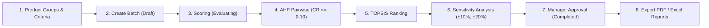
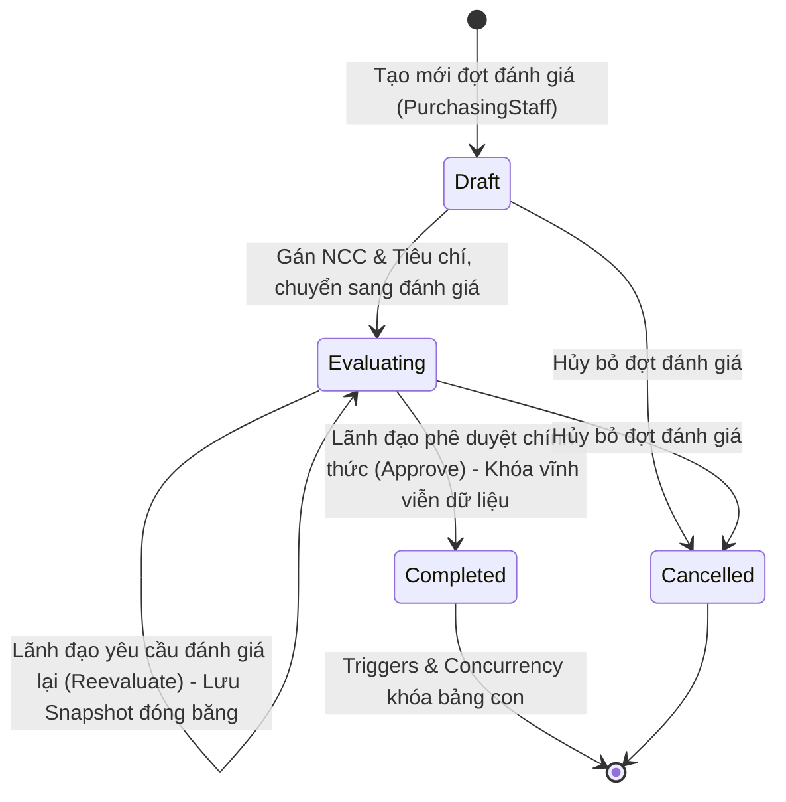

# Hệ Thống Hỗ Trợ Ra Quyết Định Lựa Chọn Nhà Cung Cấp (Supplier Selection DSS)

[](https://github.com/daongochan/Supplier_Selection_Decision_Support_System/actions/workflows/ci.yml)
[](https://dotnet.microsoft.com/)
[](LICENSE)

> **English Summary:** An enterprise-grade Decision Support System (DSS) engineered with **ASP.NET Core 10 MVC**, **Entity Framework Core 10**, and **Microsoft SQL Server**. The system implements the **Analytic Hierarchy Process (AHP)** to calculate criteria weights via Row Geometric Mean Method (RGMM) with consistency checking ($CR \le 0.10$), and the **Technique for Order of Preference by Similarity to Ideal Solution (TOPSIS)** with Standard Competition Ranking ("1224") to rank competing suppliers. It incorporates academic **Sensitivity Analysis** ($\pm 10\%, \pm 20\%$ weight perturbation), immutable evaluation round snapshots, multi-format secure reporting (**QuestPDF** & **ClosedXML**), defense-in-depth security, and a 100% verified test suite of 190 automated tests.

---

## 1. Giới thiệu dự án

Dự án là hệ thống hỗ trợ ra quyết định nội bộ (Decision Support System - DSS) phục vụ công tác mua sắm, thẩm định và quản lý chuỗi cung ứng doanh nghiệp. Hệ thống giải quyết bài toán ra quyết định đa tiêu chí (MCDM - Multi-Criteria Decision Making) khi lựa chọn nhà cung cấp tối ưu giữa nhiều phương án cạnh tranh:

1. **Xác định trọng số tiêu chí (AHP):** Chuyên gia thực hiện so sánh cặp theo thang đo chuẩn Saaty 17 mức giá trị (`1/9` đến `9`). Trọng số được tính toán bằng phương pháp trung bình nhân theo hàng (RGMM - Row Geometric Mean Method) kèm kiểm tra tự động tỷ số nhất quán ($CR \le 0.10$). Hệ thống bảo đảm tính đối xứng nghịch đảo tuyệt đối ($a_{ji} = 1/a_{ij}$), không bị lệch do làm tròn số thập phân.
2. **Xếp hạng nhà cung cấp (TOPSIS):** Chuẩn hóa ma trận đánh giá vector, xác định giải pháp lý tưởng dương ($PIS$) và âm ($NIS$), tính khoảng cách Euclid đa chiều, xác định độ tương đồng tương đối ($CC_i$), và xếp hạng theo chuẩn Standard Competition Ranking ("1224") khi có trường hợp đồng hạng điểm số.
3. **Phân tích độ nhạy (Sensitivity Analysis):** Khảo sát biến thiên trọng số từng tiêu chí ở các mức $\pm 10\%$ và $\pm 20\%$, tự động tái chuẩn hóa tổng trọng số bằng 1, đánh giá độ ổn định của nhà cung cấp dẫn đầu và phát hiện các điểm đảo chiều xếp hạng (Rank Inversion).
4. **Phê duyệt phân quyền & Báo cáo hoàn chỉnh:** Quy trình phê duyệt minh bạch yêu cầu nhập lý do giải trình khi chọn nhà cung cấp không xếp hạng 1. Hệ thống hỗ trợ đóng băng dữ liệu vòng đánh giá (Immutable Round Snapshots) và xuất báo cáo hoàn chỉnh dưới định dạng PDF chuyên nghiệp (QuestPDF) và bảng tính Excel đa trang (ClosedXML).

---

## 2. Tính năng chính theo vai trò người dùng

Hệ thống phân quyền nghiêm ngặt dựa trên vai trò (Role-Based Access Control - RBAC) qua 4 vai trò độc lập:

| Vai trò | Phạm vi chức năng & Quyền hạn | Controller phụ trách |
| :--- | :--- | :--- |
| **Administrator** | Toàn quyền quản trị hệ thống: Quản lý người dùng và trạng thái tài khoản; Tra cứu Audit Log kèm bộ lọc hành động và định dạng diff JSON; Quản lý danh mục nhóm hàng, tiêu chí và nhà cung cấp; Giám sát toàn bộ các đợt đánh giá; Can thiệp phê duyệt và xuất báo cáo khi cần thiết. | `UserController`<br>`AuditLogController`<br>`CriteriaController`<br>`ProductGroupController`<br>`SupplierController` |
| **PurchasingStaff** | Phụ trách chuẩn bị dữ liệu mua sắm: Quản lý danh mục nhóm hàng và gán nhà cung cấp vào nhóm hàng; Quản lý tiêu chí đánh giá (Benefit/Cost); Khởi tạo đợt đánh giá mới (`Draft`); Thiết lập nhà cung cấp và tiêu chí tham gia; Nhập và lưu trữ bảng điểm đánh giá thô (`Evaluating`). | `ProductGroupController`<br>`SupplierController`<br>`CriteriaController`<br>`EvaluationBatchController`<br>`EvaluationController` |
| **Expert** | Chuyên gia đánh giá kỹ thuật và chuyên môn: Nhập điểm thẩm định chuyên sâu; Thực hiện so sánh cặp ma trận AHP với bộ chọn thang đo Saaty trực tiếp (`1/9` đến `9`), tự động đối xứng nghịch đảo và kiểm tra $CR \le 0.10$; Kích hoạt tính toán xếp hạng TOPSIS và kiểm tra kết quả xếp hạng sơ bộ. | `EvaluationController`<br>`AHPController`<br>`TOPSISController` |
| **Manager** | Lãnh đạo thẩm định và ra quyết định: Giám sát tiến độ đợt đánh giá; Xem ma trận TOPSIS và biểu đồ phân tích độ nhạy ($\pm 10\%, \pm 20\%$); Thực hiện phê duyệt chính thức (`Approve`) kèm giải trình bắt buộc khi chọn NCC ngoài Top 1; Từ chối (`Reject`) hoặc yêu cầu đánh giá lại (`Reevaluate`) kèm lưu vết snapshot lịch sử; Xem và tải báo cáo PDF / Excel. | `DecisionResultController`<br>`ReportController`<br>`DashboardController` |

---

## 3. Công nghệ sử dụng (Tech Stack)

Các phiên bản thành phần được xác thực trực tiếp từ tệp cấu hình dự án (`SupplierSelectionDSS.csproj` & `SupplierSelectionDSS.Tests.csproj`):

- **Nền tảng chính:** .NET 10 (`net10.0`), ASP.NET Core MVC (Razor Views), C# 13.
- **Cơ sở dữ liệu & ORM:**
  - Microsoft SQL Server (Collation: `Vietnamese_CI_AS`).
  - Microsoft Entity Framework Core: `10.0.11` (`SqlServer`, `Design`, `Tools`, `InMemory`).
- **Mã hóa & Xác thực:**
  - `BCrypt.Net-Next`: `4.2.0` (Băm mật khẩu Salted BCrypt `$2a$11$...`).
  - ASP.NET Core Cookie Authentication kèm kiểm tra `UserCookieSecurityStamp` trên từng yêu cầu.
  - ASP.NET Core RateLimiter (chính sách `LoginLimiter` 15 req/min theo IP).
- **Xuất báo cáo & Xử lý tài liệu:**
  - `QuestPDF`: `2026.7.3` (Xuất báo cáo thẩm định PDF vector chuẩn Enterprise).
  - `ClosedXML`: `0.105.1` (Xuất bảng tính Excel đa sheet, định dạng số và công thức).
- **Giao diện & Tối ưu tài nguyên:**
  - CSS custom design tokens (`wwwroot/css/tokens.css`, Navy `#0f172a` & Gold `#d97706`).
  - Font Source Serif 4 và Bootstrap Icons v1.11.3 cục bộ 100% (không phụ thuộc CDN ngoài).
  - Bộ nén HTTP động Brotli + Gzip (`CompressionLevel.Fastest`).
- **Kiểm thử tự động:**
  - `xunit`: `2.9.3` & `xunit.runner.visualstudio`: `3.1.4`.
  - `FluentAssertions`: `7.2.0`.
  - `Moq`: `4.20.72`.
  - `coverlet.collector`: `6.0.4` (Thu thập độ bao phủ kiểm thử Cobertura XML).
  - Python 3.10+ kèm `numpy` (Công cụ đối chiếu độc lập AHP Eigenvector & TOPSIS).

---

## 4. Sơ đồ luồng nghiệp vụ & Vòng đời đợt đánh giá

### 4.1. Sơ đồ luồng nghiệp vụ (Business Flow)



### 4.2. Vòng đời trạng thái Batch (Batch Lifecycle State Machine)



---

## 5. Hướng dẫn cài đặt từ máy trống (Clean Setup Guide)

### 5.1. Yêu cầu tiên quyết
- **.NET 10 SDK** (phiên bản `10.0.100` trở lên; khuyến nghị `10.0.401` hoặc mới hơn). Kiểm tra bằng lệnh:
  ```bash
  dotnet --version
  ```
- **Microsoft SQL Server** (2019, 2022 hoặc LocalDB).
- *(Tùy chọn phục vụ kiểm chứng thuật toán):* **Python 3.10+** có cài đặt `numpy`.

### 5.2. Khởi tạo cơ sở dữ liệu
Cấu trúc cơ sở dữ liệu gồm **18 bảng**, **7 triggers**, **2 views** và **21 indexes**. Thực thi các tệp script SQL theo thứ tự:
1. Mở SQL Server Management Studio (SSMS), Azure Data Studio, hoặc chạy tiện ích dòng lệnh `sqlcmd`.
2. Chạy `database/01_schema.sql` (hoặc `database/scripts/Run_All.sql`) để tạo database `SupplierSelectionDSS`, bảng dữ liệu, ràng buộc toàn vẹn, triggers khóa trạng thái và views.
3. Chạy `database/02_seed.sql` để nạp dữ liệu khởi tạo mẫu: 1 nhóm hàng (`PG01`), 6 tiêu chí mẫu (`C01` đến `C06` gồm Benefit và Cost), 4 nhà cung cấp (`SUP01` đến `SUP04`) và 4 tài khoản người dùng tương ứng 4 vai trò.

### 5.3. Cấu hình chuỗi kết nối (Connection String)
Để bảo mật và không đưa chuỗi kết nối vào mã nguồn, cấu hình chuỗi kết nối qua **.NET User-Secrets** hoặc biến môi trường:

**Cách 1: Sử dụng .NET User-Secrets (Khuyến nghị cho môi trường phát triển cục bộ)**
```bash
dotnet user-secrets set "ConnectionStrings:DefaultConnection" "Server=.;Database=SupplierSelectionDSS;Trusted_Connection=True;MultipleActiveResultSets=true;TrustServerCertificate=True"
```

**Cách 2: Sử dụng biến môi trường (PowerShell)**
```powershell
$env:ConnectionStrings__DefaultConnection="Server=.;Database=SupplierSelectionDSS;Trusted_Connection=True;MultipleActiveResultSets=true;TrustServerCertificate=True"
```

*(Lưu ý: Môi trường Development đọc cấu hình dự phòng từ `appsettings.Development.json`).*

### 5.4. Chạy ứng dụng
```bash
# Khôi phục gói phụ thuộc
dotnet restore

# Chạy ứng dụng web
dotnet run --project SupplierSelectionDSS.csproj
```
Ứng dụng sẽ khởi chạy và lắng nghe tại các cổng mặc định:
- **HTTPS:** `https://localhost:7146`
- **HTTP:** `http://localhost:5218`

---

## 6. Danh sách tài khoản Demo (Demo Accounts)

Cơ sở dữ liệu mẫu đi kèm 4 tài khoản demo đã được băm an toàn bằng thuật toán BCrypt (`database/02_seed.sql`):

| Tên đăng nhập | Mật khẩu khởi tạo | Vai trò (Role) | Email | Quyền hạn chính |
| :--- | :--- | :--- | :--- | :--- |
| **`admin`** | `Admin@123456` | **Administrator** | `admin@abc-mfg.vn` | Quản trị tài khoản, tra cứu Audit Log, cấu hình hệ thống |
| **`staff01`** | `Staff@123456` | **PurchasingStaff** | `staff01@abc-mfg.vn` | Quản lý NCC, tiêu chí, tạo đợt đánh giá, nhập điểm thô |
| **`expert01`** | `Expert@123456` | **Expert** | `expert01@abc-mfg.vn` | Chuyên gia lập ma trận AHP, tính toán xếp hạng TOPSIS |
| **`mgr01`** | `Manager@123456` | **Manager** | `mgr01@abc-mfg.vn` | Xem độ nhạy, phê duyệt / yêu cầu đánh giá lại, xuất báo cáo |

> ⚠️ **Cảnh báo bảo mật:** Khi triển khai trên môi trường thử nghiệm hoặc vận hành chính thức, quản trị viên bắt buộc phải đăng nhập để đổi mật khẩu mặc định của toàn bộ tài khoản demo.

---

## 7. Kiểm thử & Kiểm chứng toán học (Automated Tests & Math Parity)

### 7.1. Chạy bộ kiểm thử tự động .NET
Toàn bộ quy trình thuật toán AHP/TOPSIS, phân tích độ nhạy, kiểm soát đồng thời lạc quan (`RowVersion`), cơ chế khóa trigger cơ sở dữ liệu, phân quyền bảo mật, kiểm soát đăng nhập chống brute-force và quy trình workflow đều được kiểm thử tự động bằng xUnit:

```bash
# Chạy kiểm thử ở cấu hình Release
dotnet test SupplierSelectionDSS.slnx -c Release

# Chạy kiểm thử kèm thu thập độ bao phủ mã nguồn
dotnet test SupplierSelectionDSS.slnx -c Release --collect:"XPlat Code Coverage"
```

**Kết quả thực tế đo đạc:**
- **Tổng số ca kiểm thử:** **190 tests**.
- **Kết quả:** **190 passed**, **0 failed**, **0 skipped** (Tỷ lệ đạt 100%).
- **Thời gian thực thi:** ~12–23 giây.

### 7.2. Độ bao phủ mã nguồn thực tế (Code Coverage)
Đo lường trực tiếp qua định dạng Cobertura XML thu thập bằng Coverlet (ngày đo: 23/10/2026):

| Lớp nghiệp vụ / Dịch vụ (Component) | Line Coverage | Branch Coverage | Trách nhiệm chính |
| :--- | :---: | :---: | :--- |
| **`TOPSISCalculationService`** | **95.65%** (484/506) | **89.02%** | Chuẩn hóa ma trận, tính PIS/NIS, khoảng cách Euclid, xếp hạng 1224 |
| **`SensitivityAnalysisService`** | **97.93%** (190/194) | **90.62%** | Biến thiên trọng số $\pm 10\%, \pm 20\%$, đánh giá đảo chiều thứ hạng |
| **`AHPCalculationService`** | **87.50%** (252/288) | **80.88%** | Tính trọng số RGMM, tỷ số nhất quán $CR$, đối xứng ma trận |
| **`SaatyScale`** | **84.90%** (90/106) | **66.66%** | Thang đo 17 mức Saaty, ánh xạ số thập phân và tính nghịch đảo chính xác |
| **`LoginAttemptService`** | **98.14%** (106/108) | **78.57%** | Giới hạn thất bại đăng nhập, lockout lũy tiến, bộ nhớ đệm an toàn |
| **`ReportService`** | **90.19%** (92/102) | **33.33%** | Điều phối sinh và tải báo cáo PDF / Excel, tải từ snapshot |
| **`UserService`** | **88.88%** (64/72) | **50.00%** | Quản lý người dùng, chống tự hạ quyền Admin cuối cùng |
| **`CriteriaService`** | **82.35%** (28/34) | **54.16%** | Thẩm định tiêu chí, khóa sửa đơn vị đo khi đã có dữ liệu |
| **`BatchConcurrencyHelper`** | **80.00%** (40/50) | **72.22%** | Xác thực và tăng nguyên tử `RowVersion` chống xung đột ghi đồng thời |
| **`AHPService`** | **70.75%** (150/212) | **58.00%** | Lưu trữ ma trận so sánh cặp, bảo vệ ràng buộc cơ sở dữ liệu |
| **`TOPSISService`** | **100.00%** (20/20) | **100.00%** | Điều phối tính toán TOPSIS và ghi kết quả xếp hạng vào DB |
| **`EvaluationBatchService`** | **100.00%** (12/12) | **100.00%** | Quản lý vòng đời và trạng thái đợt đánh giá |
| **`AuditLogService`** | **100.00%** (34/34) | **100.00%** | Ghi nhật ký kiểm toán và che giấu thông tin nhạy cảm |
| **`SupplierService`** | **100.00%** (20/20) | **100.00%** | Quản lý danh mục nhà cung cấp và trạng thái liên kết |
| **Toàn bộ hệ thống (Overall)** | **49.85%** (5,942 / 11,918) | **33.00%** | Bao gồm toàn bộ Services, Controllers, Entities, Helpers và ViewModels |

### 7.3. Kiểm chứng toán học độc lập bằng Python (NumPy) & Đồng bộ Schema
Hệ thống tích hợp 2 công cụ đối chiếu toán học và kiểm soát tính toàn vẹn cơ sở dữ liệu:

```bash
# 1. Kiểm tra tính đồng bộ cơ sở dữ liệu và chốt an toàn script SQL
python tools/verify/verify_schema_sync.py

# 2. Đối chiếu thuật toán AHP/TOPSIS độc lập bằng Python NumPy
python tools/verify/verify_mcdm.py
```

- **Kết quả Schema Sync:** Đạt 100% khớp nối giữa `01_schema.sql` và `Run_All.sql` trên toàn bộ 18 bảng, 7 triggers, 2 views, 21 indexes, có chốt an toàn chống xóa ngoài ý muốn (`SET NOEXEC ON`).
- **Kết quả đối chiếu AHP:** Sai số trọng số giữa phương pháp RGMM của C# và phương pháp Vector riêng chính xác (`numpy.linalg.eig`) trên ma trận kiểm chuẩn Saaty 4×4 là **$0.001196$ ($\approx 1.2 \times 10^{-3}$)**, bảo toàn tuyệt đối thứ tự ưu tiên.
- **Kết quả đối chiếu TOPSIS:** Khoảng cách $D^+$, $D^-$ và điểm tương đồng $CC_i$ trùng khớp chính xác; quy tắc Standard Competition Ranking ("1224") cho kết quả hòa điểm và các trường hợp biên (cột toàn 0, nhà cung cấp giống hệt nhau) đồng nhất 100%.

---

## 8. Cơ chế bảo mật (Security Mechanisms)

Hệ thống triển khai mô hình phòng thủ theo chiều sâu (Defense-in-Depth) với các chốt chặn đang hoạt động thực tế trong mã nguồn:

- **Xác thực phiên nghiêm ngặt (Live Security Stamp):** Sự kiện `OnValidatePrincipal` kiểm tra tài khoản còn `Active` trên mỗi yêu cầu, tự động thu hồi cookie phiên nếu người dùng bị khóa hoặc mật khẩu thay đổi (`AuthClaimTypes.PasswordStamp`), đồng thời tự động cập nhật Role mà không cần đăng nhập lại.
- **Bảo vệ Cookie:** Cookie xác thực đặt cờ `HttpOnly = true`, `SameSite = SameSiteMode.Lax`, `SecurePolicy = Always` trên môi trường Production, thời hạn 8 giờ kèm trượt (`SlidingExpiration`).
- **Chống Brute-Force & Rate Limiting:** Middleware `RateLimiter` giới hạn tối đa 15 yêu cầu đăng nhập/phút theo IP; dịch vụ `LoginAttemptService` dùng bộ nhớ đệm `IMemoryCache` (giới hạn 10,000 mục) khóa tạm thời tài khoản theo cặp `IP + Username` khi sai mật khẩu liên tiếp.
- **Chống CSRF toàn cục:** Bộ lọc `AutoValidateAntiforgeryTokenAttribute` được kích hoạt trên toàn bộ Controller MVC, bắt buộc kiểm tra token hợp lệ cho mọi HTTP POST/PUT/DELETE.
- **Tiêu đề phản hồi an toàn (Security Headers):** Tự động bổ sung `X-Content-Type-Options: nosniff`, `X-Frame-Options: SAMEORIGIN`, `Referrer-Policy: strict-origin-when-cross-origin`, và kích hoạt `HSTS` (30 ngày) trên kết nối HTTPS.
- **Cách ly tệp báo cáo tĩnh:** Middleware chuyên dụng chặn tuyệt đối mọi truy cập trực tiếp qua đường dẫn `/reports/*` trước khi tới `UseStaticFiles` (trả về 404 Not Found). Báo cáo chỉ được phục vụ qua `ReportController` có kiểm tra phân quyền.
- **Kiểm soát đồng thời lạc quan (Optimistic Concurrency):** Trường `RowVersion` (`byte[]` Timestamp) trên `EvaluationBatch` kết hợp dịch vụ `BatchConcurrencyHelper` ngăn ngừa ghi đè dữ liệu đánh giá khi có nhiều người thao tác cùng lúc.
- **Khóa trạng thái mức cơ sở dữ liệu:** 7 Triggers trên SQL Server ngăn chặn tuyệt đối việc thêm, sửa, xóa điểm đánh giá, so sánh cặp AHP, kết quả TOPSIS và quyết định phê duyệt khi đợt đánh giá đã ở trạng thái `Completed` hoặc `Cancelled`.
- **Che giấu dữ liệu nhạy cảm trong Audit Log:** Tự động lọc và che giấu các trường mật khẩu, hash BCrypt, token xác thực trước khi ghi vết vào bảng `AuditLogs`.

---

## 9. Cấu trúc thư mục dự án

```text
SupplierSelectionDSS/
├── .github/workflows/          # CI Pipeline tự động (.NET 10 Build, Test & Schema Verify)
├── Constants/                  # Các hằng số chuẩn hóa (UserRole, BatchStatus, SaatyScale, AuthClaimTypes...)
├── Controllers/                # Controllers điều hướng, xử lý ngoại lệ và phân quyền RBAC
├── Data/                       # ApplicationDbContext, cấu hình EF Core và ánh xạ thực thể
├── Infrastructure/             # Cấu hình dịch vụ hạ tầng bổ trợ
├── Models/                     # ViewModels cho Razor Views, Input Models và DTOs
├── Services/                   # Nghiệp vụ lõi: AHP, TOPSIS, Phân tích độ nhạy, Concurrency, Report, User
├── Views/                      # Giao diện người dùng Razor Views (giao diện tiếng Anh chuẩn hóa, theme Navy & Gold)
├── database/                   # Script khởi tạo CSDL, 18 bảng, 7 triggers, 2 views, dữ liệu mẫu seed
│   ├── scripts/                # Các script module đơn lẻ (01 -> 08) và Run_All.sql
│   └── patches/                # Bản vá schema và chốt an toàn
├── docs/                       # Tài liệu thiết kế học thuật, kiến trúc và kiểm thử
│   ├── ALGORITHMS.md           # Cơ sở toán học chi tiết (AHP RGMM, TOPSIS, Độ nhạy)
│   ├── ARCHITECTURE.md         # Kiến trúc hệ thống, luồng nghiệp vụ, bảo mật và phân quyền
│   ├── SYSTEM-AUDIT.md         # Báo cáo đánh giá hệ thống độc lập toàn diện
│   ├── USE-CASE-MATRIX.md      # Ma trận 70 ca sử dụng và kịch bản kiểm thử
│   ├── WORKFLOW-AND-PERMISSIONS.md # Quy trình phê duyệt và ma trận quyền hạn chi tiết
│   ├── PERFORMANCE-RESULTS.md  # Kết quả đo lường và tối ưu hóa hiệu năng truy vấn
│   ├── UX-CHANGES.md           # Thiết kế cải tiến trải nghiệm người dùng
│   ├── GROUP-AHP-PROPOSAL.md   # Đề xuất kiến trúc hội đồng đa chuyên gia
│   └── RELEASE-NOTES.md        # Ghi chú phát hành phiên bản hệ thống
├── tools/                      # Công cụ đo lường và kiểm chứng toán học
│   ├── perf/                   # Scripts đo lường hiệu năng, nạp dữ liệu lớn và đóng gói CSS
│   └── verify/                 # Scripts kiểm chứng AHP/TOPSIS độc lập (Python) và Schema Sync
├── wwwroot/                    # Tài nguyên tĩnh cục bộ (CSS đóng gói, JS, local fonts, icons)
├── SupplierSelectionDSS.Tests/ # Dự án kiểm thử tự động xUnit (190 automated tests)
├── CHANGELOG.md                # Lịch sử thay đổi hệ thống theo chuẩn Keep a Changelog
└── LICENSE                     # Giấy phép mã nguồn mở MIT
```

---

## 10. Tài liệu liên quan (Documentation)

Hệ thống được tài liệu hóa chi tiết phục vụ công tác bảo vệ đồ án và thẩm định kỹ thuật:

- **Cơ sở toán học thuật toán:** [`docs/ALGORITHMS.md`](docs/ALGORITHMS.md) — Chi tiết công thức RGMM AHP, chỉ số $CI/RI/CR$, khoảng cách Euclid TOPSIS và thuật toán phân tích độ nhạy.
- **Kiến trúc hệ thống & Bảo mật:** [`docs/ARCHITECTURE.md`](docs/ARCHITECTURE.md) — Mô hình MVC nhiều lớp, vòng đời đợt đánh giá, kiến trúc RBAC và cơ chế khóa đồng thời.
- **Đánh giá hệ thống & Khắc phục:** [`docs/SYSTEM-AUDIT.md`](docs/SYSTEM-AUDIT.md) — Báo cáo đánh giá rủi ro P0/P1/P2 và tiến trình xử lý toàn diện.
- **Ma trận ca sử dụng & Kiểm thử:** [`docs/USE-CASE-MATRIX.md`](docs/USE-CASE-MATRIX.md) — Ma trận 70 ca sử dụng bao quát toàn bộ các luồng nghiệp vụ.
- **Luồng phê duyệt & Phân quyền:** [`docs/WORKFLOW-AND-PERMISSIONS.md`](docs/WORKFLOW-AND-PERMISSIONS.md) — Quy trình phê duyệt và ma trận ma trận quyền hạn.
- **Tối ưu hóa hiệu năng:** [`docs/PERFORMANCE-RESULTS.md`](docs/PERFORMANCE-RESULTS.md) — Báo cáo đo lường giảm tải truy vấn SQL và đóng gói tài nguyên tĩnh.
- **Đề xuất hội đồng AHP đa chuyên gia:** [`docs/GROUP-AHP-PROPOSAL.md`](docs/GROUP-AHP-PROPOSAL.md) — Thiết kế mở rộng AHP nhóm theo phương pháp Geometric Mean (AIJ).
- **Lịch sử cập nhật dự án:** [`CHANGELOG.md`](CHANGELOG.md) — Nhật ký các bản phát hành và thay đổi kỹ thuật.

---

## 11. Hạn chế đã biết & Hướng phát triển (Known Limitations & Roadmap)

Nhằm đảm bảo tính trung thực học thuật, dự án ghi nhận các giới hạn kỹ thuật hiện tại và định hướng nâng cấp:

1. **Ma trận so sánh cặp AHP đơn chuyên gia:** Hệ thống hiện tại hỗ trợ một bộ ma trận so sánh cặp AHP chuẩn trên mỗi đợt đánh giá. Kiến trúc mở rộng cho phép nhiều chuyên gia cùng đánh giá độc lập và gộp trọng số nhóm (Group AHP) đã được thiết kế đầy đủ tại [`docs/GROUP-AHP-PROPOSAL.md`](docs/GROUP-AHP-PROPOSAL.md) và sẵn sàng tích hợp trong giai đoạn tiếp theo.
2. **Bộ nhớ đệm đăng nhập cục bộ (In-Memory Cache):** Dịch vụ chống brute-force và rate limiting sử dụng `IMemoryCache` trên bộ nhớ ứng dụng. Mô hình này hoạt động tối ưu cho mô hình triển khai máy chủ đơn (single-instance). Khi triển khai cụm cân bằng tải (load-balanced multi-node), hệ thống cần chuyển sang Distributed Cache (Redis) để đồng bộ trạng thái khóa giữa các nút.
3. **Lưu trữ tệp báo cáo:** Các tệp báo cáo xuất bản hiện được lưu trữ an toàn trong thư mục máy chủ cục bộ cách ly ngoài webroot (`App_Data/reports/`). Định hướng dài hạn có thể tích hợp dịch vụ lưu trữ đối tượng đám mây (Azure Blob Storage / AWS S3) để đáp ứng quy mô mở rộng không giới hạn.

---

## 12. Giấy phép mã nguồn (License)

Dự án được phân phối dưới giấy phép **[MIT License](LICENSE)**.
