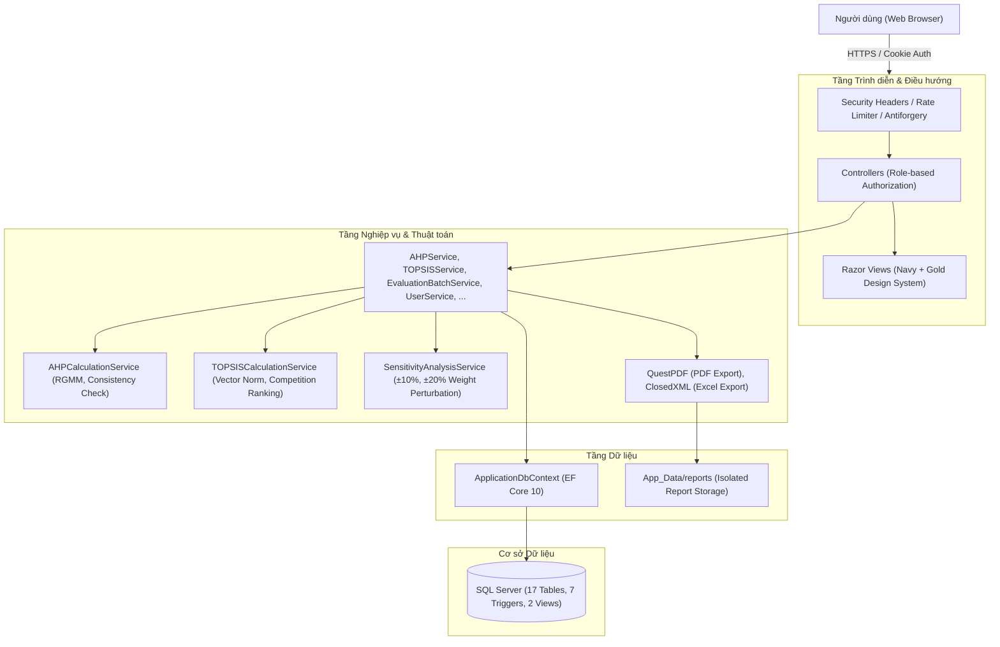
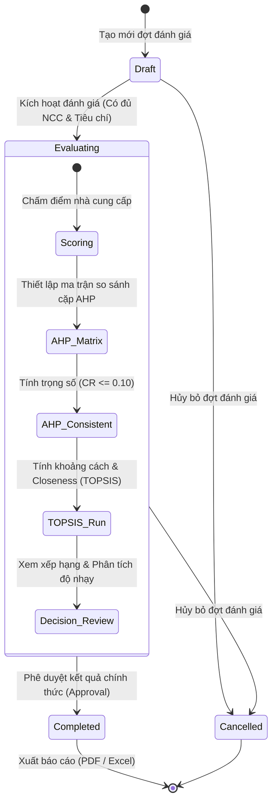
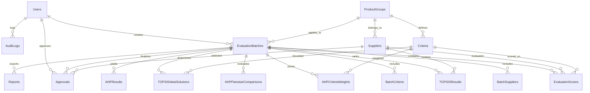

# Kiến trúc Hệ thống Supplier Selection DSS

Tài liệu này mô tả chi tiết kiến trúc tổng thể, thiết kế bảo mật, vòng đời nghiệp vụ và mô hình dữ liệu của hệ thống **Supplier Selection Decision Support System (DSS)**.

---

## 1. Kiến trúc Tổng thể (High-Level Architecture)

Hệ thống được xây dựng theo kiến trúc phân tầng (Layered Architecture) trên nền tảng **ASP.NET Core 10 (MVC)** kết hợp **Entity Framework Core 10** và cơ sở dữ liệu **Microsoft SQL Server**.

---

## 2. Vòng đời Nghiệp vụ Đợt Đánh giá (Evaluation Batch Lifecycle)

Mỗi đợt lựa chọn nhà cung cấp (`EvaluationBatch`) tuân thủ nghiêm ngặt máy trạng thái hữu hạn (Finite State Machine). Các trigger trong SQL Server và nghiệp vụ trong `EvaluationBatchService` đảm bảo không có bước nào bị nhảy cóc hoặc vi phạm toàn vẹn dữ liệu.

### Ràng buộc trạng thái:
1. **Draft:** Chỉ cho phép thêm/bớt nhà cung cấp và tiêu chí thuộc nhóm hàng. Chưa cho phép chấm điểm.
2. **Evaluating:** Ma trận điểm được khóa cấu trúc. Chuyên gia nhập điểm và lập ma trận so sánh cặp AHP. Phải đạt $CR \le 0.10$ mới được phép kích hoạt tính TOPSIS.
3. **Completed:** Đã có phê duyệt cuối cùng (`IsFinal = 1`). Mọi dữ liệu điểm số, trọng số và xếp hạng trở thành chỉ đọc (Read-only).
4. **Cancelled:** Đợt đánh giá bị hủy, không thể chỉnh sửa hay phê duyệt tiếp.

---

## 3. Kiến trúc Bảo mật (Security Architecture)

Hệ thống được thiết kế theo nguyên lý **Phòng thủ theo chiều sâu (Defense-in-Depth)** phù hợp với ứng dụng nội bộ doanh nghiệp:

### 3.1. Xác thực & Quản lý Phiên (Authentication)
- **Cơ chế:** Cookie Authentication an toàn (`HttpOnly = true`, `SameSite = Lax`, `SecurePolicy = SameAsRequest`).
- **Mã hóa mật khẩu:** Sử dụng thuật toán chuẩn công nghiệp **BCrypt** (`workFactor = 11`).
- **Chống Timing Attack:** Tại `AccountController.Login`, khi tài khoản không tồn tại, hệ thống vẫn thực thi một hàm băm BCrypt giả lập để giữ thời gian phản hồi đồng nhất với trường hợp sai mật khẩu.
- **Chống Dò quét Tài khoản (User Enumeration):** Thông báo đăng nhập luôn đồng nhất: *"Tên đăng nhập hoặc mật khẩu không chính xác"*.
- **Giới hạn Thử sai (Account Lockout):** Khóa tạm thời 15 phút nếu nhập sai mật khẩu quá 5 lần liên tiếp.

### 3.2. Bảo vệ Tệp Báo cáo & Chống Leo quyền Thư mục (Directory Traversal)
- **Tách biệt WebRoot:** Toàn bộ báo cáo PDF và Excel được lưu trữ ngoài webroot tại `App_Data/reports` (được cấu hình qua `Reports:Directory`).
- **Chặn truy cập tĩnh:** `Program.cs` cấu hình `UseStaticFiles` ngăn chặn toàn bộ các yêu cầu trực tiếp vào đường dẫn `/reports/*`, trả về mã lỗi `404 Not Found`.
- **Cổng tải an toàn:** Mọi thao tác tải file bắt buộc đi qua Action `Report/Download/{id}` có kiểm tra quyền role và ghi nhật ký kiểm toán (Audit Log).
- **Chuẩn hóa đường dẫn:** Phương thức `ReportService.GetDownloadAsync` sử dụng `Path.GetFullPath` kết hợp kiểm tra tiền tố `StartsWith(canonicalReportsDir, OrdinalIgnoreCase)` để triệt tiêu hoàn toàn nguy cơ Path Traversal (`../../`).

### 3.3. Bảo vệ Tầng Mạng & Tiêu đề Phản hồi (Security Headers)
Tích hợp Middleware tùy biến tự động chèn các tiêu đề bảo mật vào mọi phản hồi HTTP:
- `X-Content-Type-Options: nosniff` (Chống MIME-type sniffing).
- `X-Frame-Options: SAMEORIGIN` (Chống Clickjacking).
- `Referrer-Policy: strict-origin-when-cross-origin` (Bảo vệ thông tin chuyển hướng).

### 3.4. Phòng chống Tấn công Giả mạo Yêu cầu (CSRF)
- Đăng ký bộ lọc toàn cục `AutoValidateAntiforgeryTokenAttribute` trong `Program.cs`, tự động bảo vệ tất cả các HTTP method thay đổi trạng thái (`POST`, `PUT`, `DELETE`).

---

## 4. Ma trận Phân quyền theo Vai trò (RBAC Matrix)

Hệ thống quản lý 4 vai trò người dùng chuẩn hóa trong `Constants/UserRole.cs`:

| Chức năng | Administrator | PurchasingStaff | Expert | Manager |
| :--- | :---: | :---: | :---: | :---: |
| Quản lý Người dùng & Phân quyền | **Toàn quyền** | Không | Không | Không |
| Xem Nhật ký Kiểm toán (Audit Log) | **Toàn quyền** | Không | Không | Chỉ xem |
| Quản lý Danh mục Nhà cung cấp | **Toàn quyền** | Tạo, Sửa | Chỉ xem | Chỉ xem |
| Quản lý Nhóm hàng & Tiêu chí | **Toàn quyền** | Tạo, Sửa | Chỉ xem | Chỉ xem |
| Tạo & Quản lý Đợt đánh giá (Batch) | **Toàn quyền** | Tạo, Sửa (Draft) | Chỉ xem | Duyệt chuyển bước |
| Chấm điểm Đánh giá Nhà cung cấp | Không | Chấm điểm | Chấm điểm | Chỉ xem |
| Lập Ma trận So sánh Cặp AHP | Không | Lập ma trận | **Chuyên gia chính** | Chỉ xem |
| Chạy Thuật toán TOPSIS | Cho phép | Cho phép | Cho phép | Cho phép |
| Phê duyệt / Yêu cầu Đánh giá lại | Không | Không | Không | **Quyết định** |
| Xuất Báo cáo (PDF / Excel) | Cho phép | Chỉ xem | Chỉ xem | **Toàn quyền** |

---

## 5. Sơ đồ Cơ sở Dữ liệu (Database Schema)

Cơ sở dữ liệu gồm 17 bảng được thiết kế chuẩn hóa, sử dụng collation tiếng Việt `Vietnamese_CI_AS`:

### Các Trigger Kiểm soát Toàn vẹn Nghiệp vụ:
1. `TR_EvaluationScores_ValidateBatch`: Chặn sửa đổi điểm khi đợt đánh giá đã Completed hoặc Cancelled.
2. `TR_AHPPairwise_ValidateBatch`: Đảm bảo chỉ nhập ma trận AHP khi đợt ở trạng thái Evaluating.
3. `TR_BatchSuppliers_ValidateBatch`: Ngăn thêm bớt nhà cung cấp sau khi đợt đã bắt đầu đánh giá.
4. `TR_BatchCriteria_ValidateBatch`: Ngăn thêm bớt tiêu chí sau khi đợt đã bắt đầu đánh giá.
5. `TR_Approvals_ValidateState`: Đảm bảo chỉ phê duyệt khi TOPSIS đã chạy và đợt ở trạng thái hợp lệ.
6. `TR_Prevent_Demote_Last_Admin`: Ngăn hạ quyền Administrator cuối cùng của hệ thống.
7. `TR_Prevent_Deactivate_Last_Admin`: Ngăn vô hiệu hóa Administrator cuối cùng của hệ thống.
