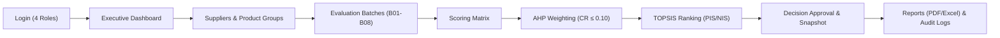

# Supplier Selection Decision Support System (DSS)
## Comprehensive Demonstration Guide & Reproducible Dataset Reference

---

## 1. Executive Summary and Architecture

The **Supplier Selection Decision Support System (DSS)** demo dataset provides a reproducible, realistic, and mathematically validated environment designed for stakeholder walkthroughs, executive evaluations, and automated testing.

The demo environment models an enterprise procurement organization conducting Multi-Criteria Decision-Making (MCDM) across diverse purchasing categories using **Analytic Hierarchy Process (AHP)** for criteria weighting and **Technique for Order of Preference by Similarity to Ideal Solution (TOPSIS)** for supplier ranking.



### Complete Database Isolation and Safety Guards

To protect operational integrity and prevent data loss, the demo dataset is strictly quarantined:

> [!IMPORTANT]
> - **Target Database:** `SupplierSelectionDSS_Demo` exclusively.
> - **Operational Safeguard:** The Demo Seeder and verification scripts enforce hard programmatic guards that immediately abort execution if the target connection string contains `SupplierSelectionDSS` (operational), `SupplierSelectionDSS_Perf` (performance benchmark), or system databases (`master`, `model`, `msdb`, `tempdb`).
> - **Database Schema:** 100% equivalent to the production schema (`database/01_schema.sql` / `Run_Production.sql`), including all 18 base tables, 2 views, 7 business triggers, and 21 custom indexes.
> - **Algorithm Integrity:** Seeded data is processed through the genuine EF Core application services (`AHPCalculationService`, `TOPSISCalculationService`, `DecisionResultService`, `ReportService`), verifying domain invariants and database triggers.

---

## 2. Target Database Setup & Seeding

### 2.1. Initial Database Provisioning (One-Time Setup)

If `SupplierSelectionDSS_Demo` does not exist or needs a complete clean reset from canonical schema, execute the production runner with the database name parameter:

```powershell
# Navigate to database scripts directory
cd database/scripts

# Execute production runner targeting SupplierSelectionDSS_Demo
sqlcmd -S . -E -C -b -v DatabaseName=SupplierSelectionDSS_Demo -i Run_Production.sql
```

This provisions the complete schema with collation `Vietnamese_CI_AS` and recovery model `FULL`.

### 2.2. Executing the Demo Seeder CLI

The seeder tool is located in `tools/demo/DemoSeeder/` and supports automated seeding, verification, dry-run simulation, and date anchoring.

```powershell
# Execute full idempotent demo seed (with automatic post-seed verification)
dotnet run --project tools/demo/DemoSeeder/DemoSeeder.csproj -- --seed

# Dry-run preview without modifying database
dotnet run --project tools/demo/DemoSeeder/DemoSeeder.csproj -- --seed --dry-run

# Run deep verification on an existing demo database
dotnet run --project tools/demo/DemoSeeder/DemoSeeder.csproj -- --verify

# Optional: Anchor timeline to a specific date (defaults to current date)
dotnet run --project tools/demo/DemoSeeder/DemoSeeder.csproj -- --seed --as-of-date 2026-10-26
```

### 2.3. Executing SQL Verification

A standalone T-SQL verification audit script is provided at `tools/demo/verify_demo.sql`:

```powershell
sqlcmd -S . -E -C -d SupplierSelectionDSS_Demo -i tools/demo/verify_demo.sql
```

### 2.4. Configuring the Web Application for Demo Mode

To launch the web application connected to `SupplierSelectionDSS_Demo`, update the connection string in `appsettings.Development.json` or pass the environment variable `ConnectionStrings__DefaultConnection`:

```json
{
  "ConnectionStrings": {
    "DefaultConnection": "Server=.;Database=SupplierSelectionDSS_Demo;Trusted_Connection=True;TrustServerCertificate=True;MultipleActiveResultSets=True"
  }
}
```

Then start the application:

```powershell
dotnet run --project SupplierSelectionDSS.csproj
```

The application will be available at `http://localhost:5000` (or `https://localhost:5001`).

---

## 3. Demo User Accounts & Access Matrix

All demo accounts are pre-configured with BCrypt cost factor 11. The default password across all accounts is **`Demo@123456`** (configurable via environment variable `DEMO_PASSWORD`).

| Username | Full Name | Role | Status | Key Demonstration Capabilities |
| :--- | :--- | :--- | :--- | :--- |
| **`demo.admin`** | Demo Administrator | Administrator | Active | Full system access, User Management, Audit Logs, Exporting/Downloading PDF & Excel reports. |
| **`demo.staff`** | Demo Purchasing Staff | PurchasingStaff | Active | Create & configure evaluation batches, assign suppliers/criteria, enter quantitative scores, run TOPSIS calculations. |
| **`demo.expert`** | Demo Evaluation Expert | Expert | Active | Enter expert evaluation scores (0–10 scale), construct AHP pairwise comparison matrices, calculate consistency ratio (CR). |
| **`demo.manager`** | Demo Procurement Manager | Manager | Active | Review TOPSIS rankings, approve/reject supplier selection decisions, request re-evaluation, cancel batches. |
| **`demo.inactive`** | Demo Inactive Expert | Expert | Inactive | Demonstrates security access controls (login blocked with account inactive notification). |

---

## 4. Master Data Catalog

### 4.1. Product Groups (4 Categories)

| Code | Name | Status | Description |
| :--- | :--- | :--- | :--- |
| **`DEMO-PG01`** | Office Supplies & Stationery | Active | Office stationery, printing paper, consumable supplies, packaging materials. |
| **`DEMO-PG02`** | IT Equipment & Enterprise Hardware | Active | High-performance servers, workstations, data center switches, enterprise laptops. |
| **`DEMO-PG03`** | Logistics & Warehouse Services | Active | Third-party logistics (3PL), freight forwarding, warehousing, express delivery. |
| **`DEMO-PG04`** | Archived / Deprecated Product Group | Inactive | Legacy archived group for filtering, role boundaries, and audit trail tests. |

### 4.2. Suppliers (12 Enterprises)

| Code | Supplier Name | Tax Code | Business Field | Status | Assigned Groups |
| :--- | :--- | :--- | :--- | :--- | :--- |
| **`DEMO-S01`** | Công ty CP Văn phòng phẩm Hồng Hà | 0100100101 | Stationery & Paper | Active | PG01 |
| **`DEMO-S02`** | Công ty CP Tập đoàn Thiên Long | 0301464830 | Writing Instruments & Office Tools | Active | PG01 |
| **`DEMO-S03`** | Công ty TNHH TM DV Tân Phú Vinh | 0304567890 | Multi-category: Stationery & 3PL Logistics | Active | PG01, PG03 |
| **`DEMO-S04`** | Công ty TNHH Thiết bị VP Phúc Thịnh | 0309876543 | Office Equipment & Consumables | Active | PG01 |
| **`DEMO-S05`** | Công ty CP Công nghệ FPT IS | 0101234567 | Enterprise Servers & Cloud Hardware | Active | PG02 |
| **`DEMO-S06`** | Công ty CP Đầu tư Thương mại CMC | 0102345678 | Data Center & Network Infrastructure | Active | PG02 |
| **`DEMO-S07`** | Công ty TNHH Phân phối Synnex FPT | 0303456789 | IT Hardware & Laptops Distribution | Active | PG02 |
| **`DEMO-S08`** | Công ty CP Thế Giới Số (Digiworld) | 0302888999 | Commercial IT & Digital Peripherals | Active | PG02 |
| **`DEMO-S09`** | Tổng Công ty CP Bưu chính Viettel | 0104050607 | Express Delivery & Warehouse Network | Active | PG03 |
| **`DEMO-S10`** | Công ty CP Giao Hàng Tiết Kiệm | 0106070809 | E-commerce Logistics & Fulfillment | Active | PG03 |
| **`DEMO-S11`** | Công ty TNHH Vận tải Hải Yến (Ngừng HĐ) | 0108889999 | Domestic Trucking | Inactive | PG03 |
| **`DEMO-S12`** | Công ty TNHH VPP Sao Mai (Ngừng HĐ) | 0107778888 | General Stationery | Inactive | PG01, PG04 |

> [!NOTE]
> - `DEMO-S03` demonstrates **multi-category suppliers** (assigned to both Office Supplies and Logistics).
> - `DEMO-S12` is an **inactive supplier** assigned to `DEMO-PG01` to demonstrate the "Assign Suppliers" UI rule: existing inactive associations are visually distinguished and cannot be added to new evaluation batches.

### 4.3. Evaluation Criteria (7 Criteria)

| Code | Criterion Name | Type | Unit | Scale Type | Description |
| :--- | :--- | :--- | :--- | :--- | :--- |
| **`DEMO-C01`** | Đơn giá chào hàng (Unit Price) | **Cost** | VND | Quantitative | Quoted price per unit (lower is preferred). |
| **`DEMO-C02`** | Chất lượng kỹ thuật (Product Quality) | **Benefit** | Điểm | **Rating Scale (0–10)** | Technical compliance, durability, failure rate (higher is preferred). |
| **`DEMO-C03`** | Thời gian giao hàng (Lead Time) | **Cost** | Ngày | Quantitative | Average delivery duration from order confirmation (shorter is preferred). |
| **`DEMO-C04`** | Năng lực cung ứng (Supply Capacity) | **Benefit** | Điểm | **Rating Scale (0–10)** | Production capacity and surge demand handling (higher is preferred). |
| **`DEMO-C05`** | Dịch vụ bảo hành & hậu mãi (After-Sales) | **Benefit** | Điểm | **Rating Scale (0–10)** | On-site warranty policy, support speed, SLAs (higher is preferred). |
| **`DEMO-C06`** | Thời hạn thanh toán linh hoạt (Payment Terms) | **Benefit** | Ngày | Quantitative | Credit terms / deferred payment window in days (longer is preferred). |
| **`DEMO-C07`** | Chỉ số kiểm định cũ (Legacy Metric) | **Cost** | VND | Quantitative | **Inactive** legacy inspection metric for archive filtering demonstration. |

---

## 5. Demonstration Batch Scenario Catalog

The demo dataset provisions **8 evaluation batches** covering all lifecycle stages and edge cases across the procurement process:

| Batch Code | Product Group | Lifecycle Status | Suppliers | Criteria | Scores | AHP State | TOPSIS State | Decision | Reports |
| :--- | :--- | :--- | :---: | :---: | :---: | :---: | :---: | :---: | :---: |
| **`DEMO-B01`** | Office Supplies | **Completed** | 4 | 4 | 16/16 | Consistent (CR = 0.0179) | Calculated | Approved | 2 (PDF, XLSX) |
| **`DEMO-B02`** | IT Equipment | **Completed** | 3 | 4 | 12/12 | Consistent (CR = 0.0076) | Calculated | Approved | 2 (PDF, XLSX) |
| **`DEMO-B03`** | Logistics Services | **Evaluating** | 3 | 4 | 12/12 | Consistent (CR = 0.0115) | Calculated | *Pending Approval* | None |
| **`DEMO-B04`** | Office Supplies | **Evaluating** | 3 | 4 | 12/12 | Consistent (CR = 0.0179) | *Pending Calculation* | None | None |
| **`DEMO-B05`** | IT Equipment | **Evaluating** | 3 | 4 | 12/12 | **Inconsistent (CR = 2.7330)** | Blocked (CR > 0.10) | None | None |
| **`DEMO-B06`** | Logistics Services | **Evaluating** | 3 | 4 | **7/12** | Pending Scores | Blocked | None | None |
| **`DEMO-B07`** | Office Supplies | **Draft** | 2 | 2 | 0/4 | Unconfigured | Unconfigured | None | None |
| **`DEMO-B08`** | IT Equipment | **Cancelled** | 2 | 2 | 0/4 | Cancelled | Cancelled | None | None |

---

### Detailed Scenario Walkthroughs

#### Scenario 1: `DEMO-B01` — Fully Completed & Approved Office Supplies Tender
- **Objective:** Demonstrates the end-to-end outcome of a successful procurement tender.
- **Workflow State:** `Completed` with Final Approval by `demo.manager`.
- **Key Features:**
  - Complete 4x4 evaluation matrix with mixed Cost (`VND`, `Ngày`) and Benefit (`Điểm`) criteria.
  - Consistent AHP weighting with CR = 0.0179 (well below 0.10 threshold).
  - TOPSIS ranking with Closeness Coefficients: S01 ranks #1 ($C_i \approx 0.638$).
  - Frozen **FinalApproval Snapshot** preserved in `BatchRoundSnapshots`.
  - Fully exportable **PDF Executive Report** and **Excel Detailed Workbook** available in `App_Data/reports`.

#### Scenario 2: `DEMO-B02` — High-Tech Server & Network Infrastructure Procurement
- **Objective:** Demonstrates enterprise hardware evaluation with high technical quality weighting.
- **Workflow State:** `Completed` with Final Approval.
- **Key Features:**
  - High unit values (VND 790M–850M) normalized properly alongside 0–10 score scales.
  - AHP weighting places 45% weight on Product Quality and 27% on Capacity, prioritizing reliability over price.
  - Complete sensitivity analysis showing how rank reversals behave when weights fluctuate.

#### Scenario 3: `DEMO-B03` — Live Approval Ready (Logistics Services)
- **Objective:** **PRIMARY DEMO POINT FOR MANAGERS.** Ready for live approval action.
- **Workflow State:** `Evaluating`, Ready for Approval.
- **Key Features:**
  - Scoring and AHP weighting are completed and consistent (CR = 0.0115).
  - TOPSIS has calculated rankings: DEMO-S09 (Viettel Post) is ranked #1 ($C_i \approx 0.612$), DEMO-S03 (Tân Phú Vinh) ranked #2, DEMO-S10 (GHTK) ranked #3.
  - **Live Action:** Log in as `demo.manager`, navigate to `Decision & Approval`, review rankings and sensitivity analysis, enter approval notes, and click **"Approve Selected Supplier"**.
  - **Result:** Batch automatically transitions to `Completed`, creating an immutable frozen snapshot.

#### Scenario 4: `DEMO-B04` — Ready for TOPSIS Calculation
- **Objective:** Demonstrates the algorithmic execution of the TOPSIS engine.
- **Workflow State:** `Evaluating`, Ready for TOPSIS.
- **Key Features:**
  - Scoring matrix is complete (12/12 cells).
  - AHP matrix is consistent (CR = 0.0179).
  - **Live Action:** Log in as `demo.staff` or `demo.expert`, open the TOPSIS tab, review input weights and decision matrix, and click **"Calculate TOPSIS"**.
  - **Result:** System calculates normalized matrix, weighted normalized matrix, positive/negative ideal solutions (PIS/NIS), relative closeness, and ranks.

#### Scenario 5: `DEMO-B05` — AHP Inconsistency Warning & Recovery
- **Objective:** Demonstrates decision science guardrails against irrational or circular judgments.
- **Workflow State:** `Evaluating`, Inconsistent AHP ($CR = 2.7330 > 0.10$).
- **The Issue:**
  - Pairwise comparisons contain a strong circular preference: Price > Quality ($7$), Quality > Capacity ($8$), but Capacity > Price ($9$).
  - This extreme logical contradiction causes $\lambda_{max} \approx 6.46$ and $CR = 2.7330$, triggering a prominent yellow warning in the UI: *"CR = 2.7330 > 0.10. Consistency threshold exceeded. TOPSIS calculation is blocked."*
- **Live Recovery Walkthrough:**
  1. Log in as `demo.expert`.
  2. Open AHP Pairwise Comparisons for `DEMO-B05`.
  3. Adjust the conflicting judgment: change `Capacity (C04)` vs `Price (C01)` from $9$ to $1/4$ (or Price vs Capacity to $4$).
  4. Click **"Save Comparisons & Calculate AHP"**.
  5. The consistency ratio drops below $0.10$, unblocking the batch for TOPSIS execution!

#### Scenario 6: `DEMO-B06` — Incomplete Scoring Matrix
- **Objective:** Demonstrates data completeness validation and workflow gating.
- **Workflow State:** `Evaluating`, Scoring in Progress (7 of 12 cells filled).
- **Key Features:**
  - Visual readiness bar displays 58% completeness.
  - Buttons for AHP and TOPSIS calculations are gated with helpful explanatory tooltips: *"Cannot calculate until all scores are entered."*
  - Live Action: Enter remaining scores for DEMO-S09, DEMO-S10, and DEMO-S03 to advance the workflow.

#### Scenario 7: `DEMO-B07` — Draft Tender Planning
- **Objective:** Demonstrates the creation and initial configuration of a new batch.
- **Workflow State:** `Draft`.
- **Key Features:**
  - Shows how Purchasing Staff configures dates, assigns eligible suppliers from `DEMO-PG01`, and selects applicable evaluation criteria before launching the evaluation round.

#### Scenario 8: `DEMO-B08` — Cancelled Tender with Audit Reason
- **Objective:** Demonstrates lifecycle governance and immutable cancellation tracking.
- **Workflow State:** `Cancelled`.
- **Key Features:**
  - All form controls are locked (read-only mode).
  - Reason for cancellation displayed: *"Hủy do thay đổi kế hoạch ngân sách và chuyển dịch trọng tâm sang dịch vụ Cloud Storage."*
  - Full audit trail recorded in Audit Logs.

---

## 6. Step-by-Step 10–15 Minute Live Presentation Script

Use this script during a live presentation to deliver a compelling, professional end-to-end demonstration.

```
⏱️ TIMELINE BREAKDOWN:
00:00 - 02:00 | Act 1: Executive Overview & Dashboard (demo.manager)
02:00 - 04:00 | Act 2: Master Data & Category Management (demo.staff)
04:00 - 06:00 | Act 3: Evaluation Batches & Workflow Gating (demo.staff)
06:00 - 08:30 | Act 4: Decision Science in Action: AHP & Inconsistency Recovery (demo.expert)
08:30 - 10:30 | Act 5: Multi-Criteria TOPSIS Evaluation & Ranking (demo.staff)
10:30 - 12:30 | Act 6: Executive Decision Approval & Frozen Snapshots (demo.manager)
12:30 - 14:00 | Act 7: Enterprise Reports & System Audit Trail (demo.admin)
```

---

### Act 1: Executive Overview & Dashboard (00:00 – 02:00)

- **Persona:** `demo.manager` (Procurement Manager)
- **Login Credentials:** `demo.manager` / `Demo@123456`
- **Navigation:** `/Dashboard`

1. **Talking Points:**
   - *"Welcome to the Supplier Selection Decision Support System. We are currently logged in as the Procurement Manager."*
   - *"Our dashboard immediately provides high-level executive visibility: total active suppliers, active evaluation batches, ongoing decisions awaiting approval, and recent evaluation trends over the past 6 months."*
2. **Visual Highlights to Point Out:**
   - KPI cards: Active Suppliers ($10$), Active Batches, Completed Evaluations.
   - Interactive Chart: Monthly evaluation trends illustrating consistent historical activity across Q2–Q4 2026.
   - Pending Action Card: Highlights that `DEMO-B03` (Logistics Services) is currently awaiting executive approval.

---

### Act 2: Master Data & Category Management (02:00 – 04:00)

- **Persona:** `demo.staff` (Purchasing Staff)
- **Login Credentials:** Switch to `demo.staff` / `Demo@123456`
- **Navigation:** `/Suppliers` → `/ProductGroups` → `/Criteria`

1. **Suppliers Screen (`/Suppliers`):**
   - *"Here we see our enterprise supplier directory. The system manages 12 suppliers across Northern and Southern regions."*
   - Filter by status **Active**: Shows 10 qualified suppliers.
   - Filter by status **Inactive**: Shows 2 decommissioned suppliers (`DEMO-S11` and `DEMO-S12`).
   - Highlight multi-category supplier `DEMO-S03` (Tân Phú Vinh), who supplies both Office Stationery and 3PL Logistics.
2. **Assign Suppliers Screen (`/ProductGroups/AssignSuppliers?groupId=1`):**
   - Click **"Assign Suppliers"** for `DEMO-PG01`.
   - Show how inactive suppliers (`DEMO-S12`) are visually flagged and protected from accidental assignment to new batches.
3. **Criteria Screen (`/Criteria`):**
   - *"Decision criteria support both qualitative ratings and quantitative values."*
   - Point out `DEMO-C01` (Unit Price, Cost in VND) vs `DEMO-C02` (Product Quality, Benefit on a standardized 0–10 scale).
   - Show that inactive criteria (`DEMO-C07`) are cleanly segregated from active selection lists.

---

### Act 3: Evaluation Batches & Workflow Gating (04:00 – 06:00)

- **Persona:** `demo.staff`
- **Navigation:** `/EvaluationBatches` → `/EvaluationBatches/Details/{id}`

1. **Batches Overview (`/EvaluationBatches`):**
   - Point out the 8 lifecycle batches spanning `Completed`, `Evaluating`, `Draft`, and `Cancelled`.
2. **Scoring Gating Demonstration (`DEMO-B06`):**
   - Open `DEMO-B06` (Logistics Services - Scoring in Progress).
   - Point out the readiness tracker: 7 of 12 scores entered ($58\%$).
   - Point out that the system strictly prevents premature AHP or TOPSIS calculation until all evaluation criteria are scored across all competing suppliers.

---

### Act 4: Decision Science in Action — AHP Weighting & Inconsistency Recovery (06:00 – 08:30)

- **Persona:** `demo.expert` (Evaluation Expert)
- **Login Credentials:** Switch to `demo.expert` / `Demo@123456`
- **Navigation:** `/AHP/Matrix/{id}` for `DEMO-B05`

1. **Demonstrating AHP Inconsistency Warning:**
   - Open AHP Matrix for `DEMO-B05` (IT Equipment - Laptop Upgrade).
   - Point out the prominent yellow warning banner:
     > *"Consistency Ratio CR = 2.7330 > 0.10. The pairwise comparisons contain logical inconsistencies and cannot be used for final decision ranking."*
   - Explain the circular preference to the audience: *"In this tender, an evaluator judged Price much more important than Quality ($7$), Quality much more important than Capacity ($8$), but simultaneously judged Capacity much more important than Price ($9$). The system caught this mathematical impossibility automatically."*
2. **Performing Live Recovery:**
   - In the pairwise comparison matrix, find the row `Năng lực cung ứng (DEMO-C04)` vs `Đơn giá chào hàng (DEMO-C01)`.
   - Change the intensity from $9$ (Extremely preferred) to $1/4$ (Moderate preference for Price).
   - Click **"Save Comparisons & Calculate AHP"**.
   - **Visual Outcome:** The calculation succeeds instantly! The CR drops below $0.10$ ($CR \approx 0.043$), the warning banner turns into a green badge: *"Consistent (CR = 0.0430 ≤ 0.10)"*, and the calculated weights sum exactly to $1.0000$.

---

### Act 5: Multi-Criteria TOPSIS Evaluation & Ranking (08:30 – 10:30)

- **Persona:** `demo.staff`
- **Navigation:** `/TOPSIS/Workspace/{id}` for `DEMO-B04`

1. **Calculating TOPSIS:**
   - Open `DEMO-B04` (Office Supplies - Urgent Q4).
   - Point out that AHP weights are already consistent and scores are complete.
   - Click the blue button: **"Calculate TOPSIS Rankings"**.
2. **Explaining the Output:**
   - Show the **Vector Normalized Matrix**: Eliminates unit dimensional differences between VND, Days, and 0–10 Scores.
   - Show the **Weighted Normalized Matrix**: Multiplies normalized values by AHP criteria weights.
   - Show the **Ideal Solutions Table**: Displays the Positive Ideal Solution ($PIS / A^+$) and Negative Ideal Solution ($NIS / A^-$) per criterion.
   - Show the **Final Rankings Table**: Explains the Closeness Coefficient ($C_i = \frac{D^-}{D^+ + D^-}$). The supplier closest to PIS and farthest from NIS receives Rank #1.

---

### Act 6: Executive Decision Approval & Frozen Snapshots (10:30 – 12:30)

- **Persona:** `demo.manager` (Procurement Manager)
- **Login Credentials:** Switch to `demo.manager` / `Demo@123456`
- **Navigation:** `/Decision/Approve/{id}` for `DEMO-B03`

1. **Reviewing Decision Workspace:**
   - Open `DEMO-B03` (Logistics Services).
   - Point out that TOPSIS has ranked DEMO-S09 (Viettel Post) as Rank #1 ($C_i = 0.6125$), followed by DEMO-S03 ($0.5841$) and DEMO-S10 ($0.4219$).
   - Point out the **Sensitivity Analysis Chart**: Demonstrates how ranking stability holds across weight fluctuations.
2. **Executing Final Approval:**
   - Select DEMO-S09 (Rank #1).
   - Enter decision justification notes: *"Phê duyệt lựa chọn Viettel Post dựa trên năng lực giao vận phủ khắp các tỉnh phía Bắc và điểm số TOPSIS cao nhất."*
   - Click **"Approve Selected Supplier"**.
   - Point out the resulting confirmation badge: Status updates to **Completed**, and a tamper-evident **FinalApproval Snapshot** is sealed in the audit store.
   - Explain that all scoring, weights, and results are now frozen and protected against modification by database triggers.

---

### Act 7: Enterprise Reports & System Audit Trail (12:30 – 14:00)

- **Persona:** `demo.admin` (Administrator)
- **Login Credentials:** Switch to `demo.admin` / `Demo@123456`
- **Navigation:** `/Reports/Details/{id}` for `DEMO-B01` → `/AuditLogs`

1. **Enterprise Reporting (`/Reports/Details/{id}`):**
   - Open Reports for `DEMO-B01`.
   - Click **"Download PDF Report"**: Opens the beautifully formatted QuestPDF executive document with executive summary, criteria weights, normalized matrices, and sign-off block.
   - Click **"Download Excel Report"**: Opens the multi-tab ClosedXML workbook containing raw data, formulas, and ranking breakdown.
2. **System Audit Logs (`/AuditLogs`):**
   - Navigate to `/AuditLogs`.
   - Point out the comprehensive, chronological audit trail recording every user login, batch creation, scoring entry, AHP calculation, TOPSIS execution, approval decision, and report download.
   - Conclude: *"Every single operation in the system is auditable, mathematically verified, and enterprise-ready."*

---

## 7. Troubleshooting, Resetting & Verification Reference

### 7.1. Idempotent Reset and Re-seeding

If during a live demonstration any batch is modified, approved, or deleted, you can restore the entire demonstration dataset back to its pristine state in less than 10 seconds:

```powershell
dotnet run --project tools/demo/DemoSeeder/DemoSeeder.csproj -- --seed
```

The seeder cleanly deletes existing `DEMO-` records and regenerates all accounts, suppliers, criteria, matrices, calculations, snapshots, and reports. Non-demo data is never touched.

### 7.2. Automated Integration Test Suite

The demo dataset integrity is permanently protected by automated integration tests:

```powershell
# Run the demo dataset test suite
dotnet test SupplierSelectionDSS.slnx -c Release --filter "FullyQualifiedName~DemoDatasetVerificationTests"

# Run the complete project test suite (215+ tests)
dotnet test SupplierSelectionDSS.slnx -c Release
```

### 7.3. Safety Guard Checklist

| Guard Rule | Enforcement Mechanism | Failure Action |
| :--- | :--- | :--- |
| **Prohibited Databases** | `DatabaseSafetyGuard.cs` checks target against `SupplierSelectionDSS`, `_Perf`, `master`, etc. | Throws `InvalidOperationException`, aborts immediately. |
| **Demo Target Only** | Database name must match `SupplierSelectionDSS_Demo` exactly. | Process exits with return code `2`. |
| **Trigger Enforcement** | SQL Server business triggers (`06_Triggers.sql`) validate relational dependencies on every write. | Transaction rollbacks with localized error message. |
| **Data Completeness** | `BatchWorkflowReadinessService.cs` gates each lifecycle step. | UI disables action buttons with status tooltip. |
| **MCDM Correctness** | AHP consistency threshold $CR \le 0.10$; TOPSIS closeness coefficient $\in [0, 1]$. | Blocks TOPSIS execution until pairwise matrix is adjusted. |
