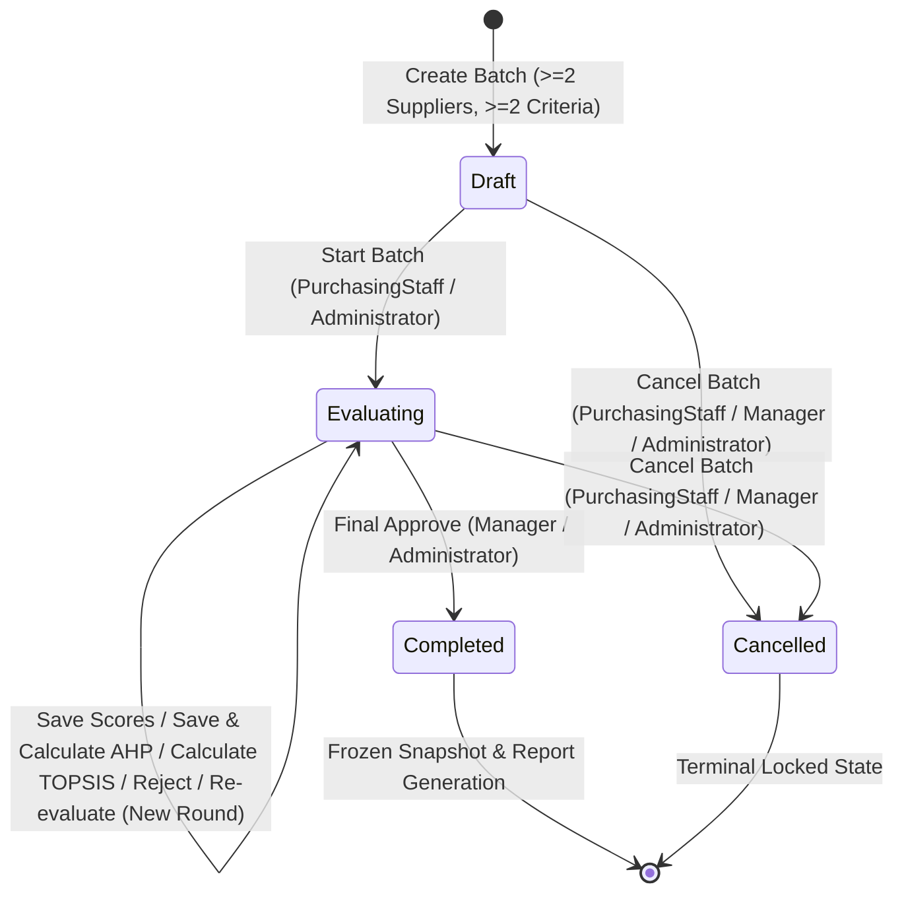

# Supplier Selection DSS — Workflow, Permissions & Concurrency Architecture

**Repository:** `https://github.com/daongochan/Supplier_Selection_Decision_Support_System`  
**Branch:** `fix/system-audit-20261023`  
**Date:** 2026-10-23

---

## 1. Evaluation Batch State Machine

Every `EvaluationBatch` progresses through a strict lifecycle enforced at three layers:
1. **Domain Rules:** `EvaluationBatchStateRules` & `BatchWorkflowReadinessService`
2. **Aggregate Concurrency Protocol:** `BatchConcurrencyHelper` (`EvaluationBatch.RowVersion`)
3. **Database Triggers:** SQL Server `AFTER INSERT, UPDATE, DELETE` triggers on scope and workflow child tables

### 1.1. State Invariants

| Batch Status | Scope (`Suppliers`, `Criteria`) | Scores / AHP / TOPSIS / Approvals | Reports (`PDF`, `Excel`) |
|---|---|---|---|
| `Draft` | Created with $\ge 2$ Active suppliers in group and $\ge 2$ Active criteria | Locked (must transition to `Evaluating` first) | Locked |
| `Evaluating` | Locked | Mutable by authorized roles; guarded by `RowVersion` | Locked |
| `Completed` | Locked (SQL Trigger + Service) | Permanently locked; served from frozen `FinalApproval` snapshot | Enabled (`Manager`, `Administrator`) |
| `Cancelled` | Locked (SQL Trigger + Service) | Permanently locked | Locked |

---

## 2. Role-Based Access Control (RBAC) Matrix

| Module / Action | `Administrator` | `PurchasingStaff` | `Expert` | `Manager` |
|---|:---:|:---:|:---:|:---:|
| **Dashboard (`/Dashboard`)** | Read | Read | Read | Read |
| **Suppliers (`/Supplier/*`)** | Full CRUD | Full CRUD | — | — |
| **Product Groups (`/ProductGroup/*`)** | Full CRUD | Full CRUD | — | — |
| **Evaluation Criteria (`/Criteria/*`)** | Full CRUD | — | Full CRUD | — |
| **Batch List & Details (`/EvaluationBatch`)** | Read | Read | Read | Read |
| **Create / Start Batch** | Execute | Execute | — | — |
| **Cancel Batch** | Execute | Execute | — | Execute |
| **Evaluation Scores (`/Evaluation/*`)** | Read & Write | Read & Write | Read & Write | — |
| **AHP Weights (`/AHP/*`)** | Read & Write | — | Read & Write | — |
| **TOPSIS Calculation (`POST /TOPSIS/Calculate`)** | Execute | — | Execute | — |
| **TOPSIS Workspace (`GET /TOPSIS`)** | Read | — | Read | Read |
| **Decision & Approval (`GET /DecisionResult`)** | Read | Read | Read | Read |
| **Approve / Reject / Re-evaluate (`POST /DecisionResult/*`)** | Execute | — | — | Execute |
| **Reports (`/Report/*`)** | Generate & Download | — | — | Generate & Download |
| **User Management (`/User/*`)** | Full CRUD | — | — | — |
| **Audit Logs (`/AuditLog`)** | Read | — | — | — |

---

## 3. Live Cookie Principal & Security Stamp Validation (F04)

To prevent stale privilege retention after account lock/deactivation, role demotion, or password reset:
1. At sign-in (`AccountController.Login`), the cookie includes claim `dss:security_stamp` computed by `UserCookieSecurityStamp.Compute(user)` (SHA-256 over `UserId`, `Status`, `Role`, and `PasswordHash`).
2. On every authenticated HTTP request, `CookieAuthenticationOptions.Events.OnValidatePrincipal` in `Program.cs` queries the user row (`AsNoTracking`):
   - **Account Deleted, `Locked`, `Inactive`, or Password Changed:** `context.RejectPrincipal()` and `HttpContext.SignOutAsync(...)` immediately revoke the session and redirect the user to `/Account/Login`.
   - **Role or Full Name Updated (while `Active` and password unchanged):** Claims are rebuilt in-place (`context.ReplacePrincipal(...)` + `context.ShouldRenew = true`) so role changes take effect on the very next request without requiring a manual sign-out.

---

## 4. Aggregate Concurrency Protocol (F03)

Because `EvaluationScores`, `AHPPairwiseComparisons`, `AHPResults`, `AHPCriteriaWeights`, `TOPSISResults`, and `Approvals` are child entities of `EvaluationBatch`, checking `RowVersion` only when `EvaluationBatch` properties change is insufficient.

All mutations to a batch or its child tables follow a unified protocol via `BatchConcurrencyHelper`:
1. Every form (`Evaluation/Save`, `AHP/Save`, `AHP/Calculate`, `TOPSIS/Calculate`, `DecisionResult/Approve`, `DecisionResult/Reject`, `DecisionResult/Reevaluate`, `EvaluationBatch/Start`, `EvaluationBatch/Cancel`) embeds `<input type="hidden" name="rowVersion" value="..." />`.
2. Inside the database transaction, `BatchConcurrencyHelper.BumpAndVerifyBatchVersionAsync` executes an atomic `UPDATE dbo.EvaluationBatches SET Status = @newStatus WHERE BatchID = @batchId AND RowVersion = @expectedRowVersion`.
3. On SQL Server, this `UPDATE` acquires an exclusive row lock (`X` lock) on the parent `EvaluationBatch` row for the duration of the transaction and increments `RowVersion`, serializing concurrent child writes and immediately failing any stale writer with `DbUpdateConcurrencyException` $\rightarrow$ `BusinessRuleException`.

---

## 5. Multi-Round Decision History & Frozen Snapshots (F05, F06)

- **Append-Only Decision History (`Approvals`):**
  - `Reject`, `RequestReevaluation`, and `Approve` append immutable records to `Approvals`.
  - Subsequent score or AHP edits during `Evaluating` never call `RemoveRange` on prior `Approvals`; instead, non-final records from earlier edits are annotated as `[Superseded at ...]`.
- **Self-Contained Frozen Snapshots (`BatchRoundSnapshots`):**
  - Both `RequestReevaluation` and `FinalApproval` serialize a `BatchRoundSnapshotData` (`SchemaVersion = 2`) payload containing all supplier codes/names, criterion codes/names/types/units, raw score matrix, AHP weights and consistency metrics, TOPSIS matrices, ranking, and sensitivity stability.
  - Once a batch is `Completed`, `DecisionResultService` and `ReportService` reconstruct all screens and PDF/Excel exports from the frozen snapshot so master-data renames never alter historical records.
