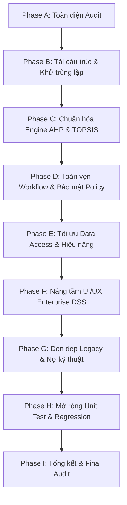

<!-- ARCHIVE_HEADER -->
> [!NOTE]
> **ARCHIVED DOCUMENT — SUPERSEDED**
> **Archived Date:** 2026-10-24  
> **Base Commit:** \d5b98db2b8b732bf0ce5491793aa73ba9136b678\  
> **Status:** Historical point-in-time document preserved for traceability. The active canonical documentation is located in \docs/\ (\DESIGN-SYSTEM.md\, \ARCHITECTURE.md\, \ALGORITHMS.md\, \WORKFLOW-AND-PERMISSIONS.md\, \docs/qa/\).

---

# KẾ HOẠCH TỐI ƯU HÓA VÀ TÁI CẤU TRÚC HỆ THỐNG (OPTIMIZATION PLAN)
**Dự án:** SupplierSelectionDSS – Decision Support System (AHP & TOPSIS)  
**Vai trò:** Senior Software Architect & Lead Developer  
**Ngày lập:** 19/09/2026  
**Ràng buộc cốt lõi:**
- Database SQL Server schema là cố định (Frozen schema). Không tự ý thay đổi bảng, cột, khóa hay triggers.
- Giữ nguyên kiến trúc Single Project, không tách đa project phức tạp.
- Đảm bảo 100% nghiệp vụ đang chạy đúng và tương thích ngược.

---

## TỔNG QUAN CÁC GIAI ĐOẠN (ROADMAP)

---

## CHI TIẾT CÁC GIAI ĐOẠN THỰC HIỆN

### PHASE A: AUDIT TOÀN DIỆN (ĐÃ HOÀN THÀNH)
- **Mục tiêu:** Rà soát 100% codebase thực tế, xác định các điểm yếu về kiến trúc, chất lượng mã nguồn, bảo mật, dữ liệu, giải thuật, quy trình và giao diện.
- **Sản phẩm:** File `docs/OPTIMIZATION-AUDIT.md` và `docs/OPTIMIZATION-PLAN.md`.
- **Tiêu chí hoàn thành:** Xác định chính xác các issue thực tế có trong repo, không đưa vào các giả định lý thuyết.

---

### PHASE B: TÁI CẤU TRÚC KIẾN TRÚC & KHỬ TRÙNG LẶP LOGIC (ARCHITECTURE & DRY)

#### 1. Mục tiêu
- Thiết lập cấu trúc thư mục phân tầng rõ ràng theo chuẩn:
  - `Domain/`: Rules, Enums, Constants
  - `Application/`: Algorithms (AHP, TOPSIS), Services, DTOs
  - `Infrastructure/`: Persistence, Exports (PDF, Excel), Audit
  - `Web/`: Controllers, ViewModels, Authorization, Extensions
- Gỡ bỏ test dependencies (`FluentAssertions`, `Moq`) khỏi production csproj.
- Khử trùng lặp code: Trích xuất Claim User ID, chuẩn hóa chuỗi input `Normalize()`, thống nhất hằng số `AuditActions`.
- Tách các class/DTO viết chung file về nguyên tắc "Mỗi class một file".

#### 2. File liên quan
- `SupplierSelectionDSS.csproj`
- `SupplierSelectionDSS.Tests/SupplierSelectionDSS.Tests.csproj`
- `Domain/Rules/EvaluationBatchStateRules.cs` (Mới)
- `Domain/Enums/EvaluationBatchStatus.cs` (Mới)
- `Web/Extensions/ClaimsPrincipalExtensions.cs` (Mới)
- `Application/Algorithms/AHP/` (Di chuyển & tái cấu trúc DTO)
- `Application/Algorithms/TOPSIS/` (Di chuyển & tái cấu trúc DTO)
- `Controllers/*.cs`
- `Program.cs`

#### 3. Thay đổi cần thực hiện
1. Điều chỉnh `SupplierSelectionDSS.csproj`: xóa `FluentAssertions` và `Moq`. Đưa `FluentAssertions` vào `SupplierSelectionDSS.Tests.csproj`.
2. Tạo extension `ClaimsPrincipalExtensions.GetUserId()` để thay thế 11 đoạn code lặp `User.FindFirst(ClaimTypes.NameIdentifier)`.
3. Tách các class phụ (`AHPCalculationResult`, `TOPSISCalculationResult`, `TOPSISSupplierDistance`, các ViewModels) thành các file độc lập.
4. Thống nhất `AuditActions` - loại bỏ class trùng lặp `AuditLogService.Actions`.
5. Đăng ký lại DI trong `Program.cs` tương ứng.

#### 4. Dependencies & Risk
- **Dependency:** Cần cập nhật đúng namespace để không gây lỗi biên dịch.
- **Risk:** Gãy reference trong Controllers hoặc Views nếu namespace thay đổi đột ngột.
- **Biện pháp giảm thiểu:** Giữ `_ViewImports.cshtml` bao quát hoặc dùng global usings; build kiểm tra ngay sau mỗi bước di chuyển.

#### 5. Cách kiểm thử & Tiêu chí hoàn thành
- `dotnet build` đạt 0 Error, 0 Warning.
- Production assembly không còn chứa `FluentAssertions` hay `Moq`.

---

### PHASE C: ĐẢM BẢO TÍNH ĐÚNG ĐẮN VÀ KIỂM THỬ ĐỘC LẬP AHP & TOPSIS (ENGINES)

#### 1. Mục tiêu
- Sửa lỗi fail hiện tại trong `TOPSISCalculationServiceTests`.
- Đảm bảo 2 engine AHP và TOPSIS hoàn toàn độc lập với database, HTTP, Razor.
- Mở rộng bảng Saaty Random Index (RI) từ n=10 lên n=15.
- Thiết lập cơ chế Cascade Invalidation:
  - Khi cập nhật `EvaluationScores`: Xóa `TopsisResults` và `TopsisIdealSolutions` cũ của Batch.
  - Khi lưu/tính toán `AHP`: Xóa `TopsisResults` và `TopsisIdealSolutions` cũ của Batch (vì trọng số đã đổi, TOPSIS cũ không còn giá trị).

#### 2. File liên quan
- `Services/TOPSISCalculationService.cs` (hoặc `Application/Algorithms/TOPSIS/`)
- `Services/AHPCalculationService.cs` (hoặc `Application/Algorithms/AHP/`)
- `Services/AHPService.cs`
- `Services/TOPSISService.cs`
- `Services/EvaluationService.cs`
- `SupplierSelectionDSS.Tests/Calculation/TOPSISCalculationServiceTests.cs`

#### 3. Thay đổi cần thực hiện
1. Sửa assertion hoặc thông điệp lỗi trong `TOPSISCalculationService.cs` và `TOPSISCalculationServiceTests.cs`.
2. Cập nhật bảng Saaty RI trong `AHPCalculationService`: thêm n=11..15.
3. Trong `EvaluationService.SaveAsync`: khi lưu điểm thành công, kiểm tra và xóa toàn bộ `TopsisResults` + `TopsisIdealSolutions` của batch để tránh kết quả xếp hạng bị stale.
4. Trong `AHPService.SaveComparisonsAsync` và `AHPService.CalculateAsync`: cascade xóa `TopsisResults` + `TopsisIdealSolutions`.

#### 4. Dependencies & Risk
- **Dependency:** Cần transaction an toàn khi xóa kết quả cũ trong database.
- **Risk:** Người dùng thắc mắc vì sao sau khi sửa điểm/sửa AHP thì kết quả TOPSIS biến mất -> Cần thông báo rõ trên giao diện: "Dữ liệu đánh giá/trọng số đã thay đổi, vui lòng tính toán lại TOPSIS".

#### 5. Cách kiểm thử & Tiêu chí hoàn thành
- Chạy `dotnet test`: 100% tests PASS (không còn test nào fail).
- Test luồng: Đã có TOPSIS -> Sửa 1 điểm đánh giá -> Kiểm tra TOPSIS đã được reset -> Tính toán lại TOPSIS ra kết quả mới chuẩn xác.

---

### PHASE D: TOÀN VẸN WORKFLOW & BẢO MẬT POLICY-BASED (WORKFLOW & SECURITY)

#### 1. Mục tiêu
- Triển khai `Domain/Rules/EvaluationBatchStateRules.cs` tập trung toàn bộ quy tắc chuyển trạng thái:
  - `Draft -> Evaluating`
  - `Evaluating -> Completed` (khi Approved)
  - `Draft -> Cancelled`
  - `Evaluating -> Cancelled`
  - Không cho phép chỉnh sửa Completed hoặc Cancelled Batch.
- Bổ sung tính năng và endpoint `CancelBatch` (chức năng bị thiếu).
- Thay thế magic role strings bằng Policy-based Authorization (`[Authorize(Policy = ...)]`).

#### 2. File liên quan
- `Domain/Rules/EvaluationBatchStateRules.cs`
- `Web/Authorization/PolicyNames.cs` (Mới)
- `Services/EvaluationBatchService.cs`
- `Controllers/EvaluationBatchController.cs`
- `Controllers/AHPController.cs`, `Controllers/TOPSISController.cs`, `Controllers/DecisionResultController.cs`
- `Program.cs`

#### 3. Thay đổi cần thực hiện
1. Tạo `EvaluationBatchStateRules` chứa các hàm kiểm tra logic trạng thái nguyên tử.
2. Viết method `CancelAsync(int batchId, int cancelledBy, string? reason)` trong `EvaluationBatchService`.
3. Bổ sung action POST `Cancel(int id, string? reason)` vào `EvaluationBatchController`.
4. Đăng ký các Policies trong `Program.cs`:
   - `PolicyNames.CanManageBatch`: Administrator, PurchasingStaff
   - `PolicyNames.CanEvaluate`: Administrator, PurchasingStaff, Expert
   - `PolicyNames.CanPerformAHP`: Administrator, Expert
   - `PolicyNames.CanPerformTOPSIS`: Administrator, Expert
   - `PolicyNames.CanApprove`: Administrator, Manager
   - `PolicyNames.CanGenerateReport`: Administrator, Manager
5. Cập nhật các Controller sử dụng Policy thay cho role string ghép thủ công.

#### 4. Dependencies & Risk
- **Dependency:** Cần tương thích với cơ chế Cookie Authentication hiện tại.
- **Risk:** Cấu hình sai policy làm người dùng hợp lệ bị AccessDenied.
- **Biện pháp giảm thiểu:** Kiểm thử kỹ phân quyền của cả 4 roles: Administrator, PurchasingStaff, Expert, Manager.

#### 5. Cách kiểm thử & Tiêu chí hoàn thành
- Chặn thành công thao tác sửa Batch đã `Completed` hoặc `Cancelled`.
- Hủy Batch thành công từ `Draft` hoặc `Evaluating` sang `Cancelled`, cập nhật `CancelledAt`.
- Quyền truy cập các action được bảo vệ chặt chẽ theo đúng ma trận vai trò.

---

### PHASE E: TỐI ƯU DATA ACCESS & HIỆU NĂNG (DATA & PERFORMANCE)

#### 1. Mục tiêu
- Xóa bỏ Over-fetching trong `EvaluationBatchService.GetDetailAsync` (thay vì Include 10 bảng, sử dụng ViewModel chuyên dụng với projection tối ưu).
- Tối ưu truy vấn Dashboard: gom các chỉ số thống kê, giảm thiểu số lượng round-trip đến database.
- Tách `ReportService` (God Class 1,799 dòng) thành các exporter chuyên biệt trong `Infrastructure/Exports/`.

#### 2. File liên quan
- `Services/EvaluationBatchService.cs`
- `Models/EvaluationBatchDetailViewModel.cs` (Mới)
- `Views/EvaluationBatch/Details.cshtml`
- `Services/DashboardService.cs`
- `Services/ReportService.cs`
- `Infrastructure/Exports/IReportExporter.cs` (Mới)
- `Infrastructure/Exports/QuestPdfReportExporter.cs` (Mới)
- `Infrastructure/Exports/ClosedXmlReportExporter.cs` (Mới)

#### 3. Thay đổi cần thực hiện
1. Tạo `EvaluationBatchDetailViewModel` chứa đầy đủ dữ liệu thống kê, tiến độ workflow và scope của Batch.
2. Viết lại `GetDetailAsync` trả về ViewModel này, sử dụng query chọn lọc, bỏ việc load thực thể thô và rò rỉ vào Razor View.
3. Cập nhật `Views/EvaluationBatch/Details.cshtml` sử dụng `@model EvaluationBatchDetailViewModel`.
4. Tách mã QuestPDF và ClosedXML từ `ReportService.cs` ra hai service xuất file riêng biệt. `ReportService` chỉ quản lý dữ liệu nghiệp vụ và điều phối xuất file.

#### 4. Dependencies & Risk
- **Dependency:** Báo cáo PDF và Excel phải giữ nguyên 100% định dạng, nội dung và thẩm mỹ hiện tại.
- **Risk:** Thiếu trường thông tin trong ViewModel khi refactor `Details.cshtml`.
- **Biện pháp giảm thiểu:** Đối chiếu kỹ từng thuộc tính đang dùng trong `Details.cshtml` trước khi chuyển đổi.

#### 5. Cách kiểm thử & Tiêu chí hoàn thành
- Trang chi tiết Batch load nhanh, hiển thị đầy đủ thông tin đợt đánh giá, scope và tiến độ.
- Xuất PDF và Excel thành công, file mở ra đúng chuẩn và không có lỗi định dạng.

---

### PHASE F: NÂNG CẤP GIAO DIỆN & TRẢI NGHIỆM ENTERPRISE DSS (UI/UX)

#### 1. Mục tiêu
- Hoàn thiện Application Shell chuẩn DSS:
  - Bổ sung **Breadcrumb** ngữ cảnh động.
  - Bổ sung **Footer** chuyên nghiệp.
  - Chuẩn hóa biểu tượng (Bootstrap Icons) đồng bộ cho toàn bộ Sidebar menu.
- Xây dựng hệ thống **Toast Notification** tập trung tự động hiển thị khi có `TempData["SuccessMessage"]` hoặc `TempData["ErrorMessage"]`.
- Triển khai **Confirmation Modals** cho các thao tác nhạy cảm:
  - Phê duyệt nhà cung cấp (Approve) kèm nhập ghi chú.
  - Từ chối (Reject) kèm nhập lý do.
  - Yêu cầu đánh giá lại (Re-evaluate) kèm cảnh báo dữ liệu tính toán cũ sẽ bị hủy.
  - Hủy đợt đánh giá (Cancel Batch).
  - Bật/Tắt trạng thái hoạt động (ToggleStatus).
- Bổ sung **Button Loading State** và ngăn chặn Double-submit trên tất cả các form tính toán/lưu trữ.
- Hiển thị bảng so sánh đa chiều (Comparison table) giữa các nhà cung cấp tại trang Decision Result.

#### 2. File liên quan
- `Views/Shared/_Layout.cshtml`
- `Views/Shared/_Topbar.cshtml`
- `Views/Shared/_Sidebar.cshtml`
- `Views/Shared/_Toast.cshtml` (Mới)
- `Views/Shared/_ConfirmationModal.cshtml` (Mới)
- `Views/DecisionResult/Index.cshtml`
- `Views/EvaluationBatch/Details.cshtml`
- `wwwroot/js/site.js`
- `wwwroot/css/` (các components css tương ứng)

#### 3. Thay đổi cần thực hiện
1. Thêm Breadcrumb vào topbar và Footer vào layout.
2. Thêm icon cho các mục menu Sidebar: Dashboard (`bi-speedometer2`), Suppliers (`bi-truck`), Product Groups (`bi-grid`), Criteria (`bi-list-check`), Batches (`bi-folder2-open`), Users (`bi-people`), Audit logs (`bi-clock-history`).
3. Tạo partial view `_Toast.cshtml` và tích hợp vào layout. Loại bỏ mã HTML alert lặp lại trong các view.
4. Xây dựng modal xác nhận chung bằng Vanilla JS/Bootstrap modal.
5. Viết JS tự động chặn double click trên form submit và hiện spinner loading.

#### 4. Dependencies & Risk
- **Dependency:** Bootstrap Icons và CSS tokens của dự án.
- **Risk:** Xung đột CSS hoặc vỡ giao diện trên màn hình nhỏ.
- **Biện pháp giảm thiểu:** Kiểm tra responsive trên các kích thước màn hình phổ biến.

#### 5. Cách kiểm thử & Tiêu chí hoàn thành
- Giao diện đạt chuẩn Enterprise DSS hiện đại, sang trọng, nhất quán.
- Mọi thao tác quan trọng đều có modal xác nhận an toàn, không còn sử dụng `confirm()` mặc định của trình duyệt.
- Toast hiển thị mượt mà và tự ẩn sau 4 giây.

---

### PHASE G: DỌN DẸP MÃ NGUỒN LEGACY & NỢ KỸ THUẬT (CLEANUP)

#### 1. Mục tiêu
- Xóa file view trùng lặp `Views/Home/Index.cshtml`.
- Điều hướng `HomeController.Index` sang `Dashboard` hoặc `Account/Login`.
- Xóa các file boilerplate không sử dụng: `Views/Home/Privacy.cshtml`, `Views/Shared/_Layout.cshtml.css`, `Views/Shared/_Pagination.cshtml.cs`.
- Rà soát và gỡ bỏ toàn bộ code chết (dead code).

#### 2. File liên quan
- `Views/Home/Index.cshtml` (Xóa)
- `Views/Home/Privacy.cshtml` (Xóa)
- `Views/Shared/_Layout.cshtml.css` (Xóa)
- `Views/Shared/_Pagination.cshtml.cs` (Xóa)
- `Controllers/HomeController.cs`

#### 3. Thay đổi cần thực hiện
1. Sửa `HomeController.Index()`: nếu authenticated chuyển hướng sang `Dashboard/Index`, nếu chưa authenticated chuyển sang `Account/Login`.
2. Xóa các file thừa đã xác nhận không có dependency.

#### 4. Dependencies & Risk
- **Risk:** Xóa nhầm file đang có tham chiếu.
- **Biện pháp giảm thiểu:** Đã kiểm tra toàn bộ references trước khi xóa, biên dịch ngay sau khi xóa.

#### 5. Cách kiểm thử & Tiêu chí hoàn thành
- `dotnet build` sạch sẽ 0 warning, 0 error.
- Không còn file rác hay view trùng lặp trong thư mục Views.

---

### PHASE H: MỞ RỘNG BỘ TEST & KIỂM THỬ HỒI QUY (TESTING)

#### 1. Mục tiêu
- Xây dựng bộ Unit Tests toàn diện cho:
  - `AHPCalculationService`: Ma trận 1x1, 2x2, 3x3, ma trận không nhất quán, ma trận nghịch đảo sai, ma trận kích thước 15 tiêu chí.
  - `TOPSISCalculationService`: Toàn bộ tiêu chí Benefit, toàn bộ Cost, hỗn hợp Benefit + Cost, xử lý mẫu số = 0 (tất cả điểm bằng nhau), kiểm tra ranking và Closeness Coefficient.
  - `EvaluationBatchStateRules`: Kiểm tra tất cả các bước chuyển trạng thái hợp lệ và không hợp lệ.
- Kiểm thử tích hợp luồng nghiệp vụ end-to-end từ tạo đợt đánh giá đến phê duyệt và báo cáo.

#### 2. File liên quan
- `SupplierSelectionDSS.Tests/Calculation/AHPCalculationServiceTests.cs`
- `SupplierSelectionDSS.Tests/Calculation/TOPSISCalculationServiceTests.cs`
- `SupplierSelectionDSS.Tests/Rules/EvaluationBatchStateRulesTests.cs` (Mới)

#### 3. Thay đổi cần thực hiện
1. Viết bổ sung các test cases kiểm thử biên cho AHP và TOPSIS.
2. Viết unit tests cho quy tắc chuyển trạng thái của Batch.

#### 4. Cách kiểm thử & Tiêu chí hoàn thành
- Chạy lệnh `dotnet test`.
- 100% tests đạt (ALL GREEN). Không có hồi quy (regression).

---

### PHASE I: TỔNG KẾT, TÀI LIỆU HÓA & BÀN GIAO (FINAL AUDIT)

#### 1. Mục tiêu
- Cập nhật tài liệu kiến trúc `docs/ARCHITECTURE.md` và danh mục kiểm thử `docs/TESTING-CHECKLIST.md`.
- Kiểm tra lại toàn bộ danh mục 42 yêu cầu từ đề bài.
- Chạy ứng dụng và nghiệm thu tổng thể.

#### 2. Sản phẩm bàn giao
- `docs/OPTIMIZATION-AUDIT.md`
- `docs/OPTIMIZATION-PLAN.md`
- `docs/ARCHITECTURE.md`
- `docs/TESTING-CHECKLIST.md`
- Codebase sạch, chuẩn mực, ổn định, hoạt động hoàn hảo.
