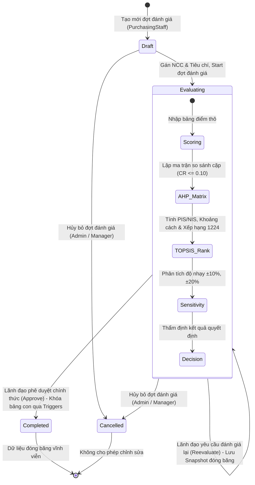

# SCREEN INVENTORY — DANH MỤC MÀN HÌNH VÀ ROUTES
## Dự án: Supplier Selection DSS (AHP + TOPSIS)
## Tài liệu QA: docs/qa/SCREEN_INVENTORY.md
## Ngày lập: 23/10/2026

---

## 1. TỔNG QUAN PHÂN QUYỀN VÀ PHẠM VI TRUY CẬP

Hệ thống áp dụng cơ chế xác thực Cookie Authentication (`SupplierSelectionDSS.Auth`) kèm phân quyền theo 4 vai trò (Role-Based Access Control - RBAC):
1. **`Administrator` (Admin):** Toàn quyền hệ thống, quản lý người dùng, xem Audit Log, cấu hình danh mục.
2. **`PurchasingStaff` (Staff):** Quản lý nhà cung cấp, nhóm hàng, tiêu chí, tạo đợt đánh giá, nhập điểm.
3. **`Expert` (Chuyên gia):** Nhập điểm chuyên môn, so sánh cặp AHP, tính toán TOPSIS.
4. **`Manager` (Lãnh đạo):** Xem độ nhạy, phê duyệt / từ chối / yêu cầu đánh giá lại đợt đánh giá, xuất báo cáo PDF/Excel.

---

## 2. MA TRẬN ĐẦY ĐỦ CÁC ROUTE & MÀN HÌNH (SCREEN INVENTORY TABLE)

| # | Route / URL | Controller.Action | HTTP Verb | View (.cshtml) | Roles được phép | Trạng thái Batch cần | Tham số & Dữ liệu đầu vào |
|---|---|---|:---:|---|---|:---:|---|
| **A** | **HỆ THỐNG & XÁC THỰC** | | | | | | |
| 1 | `/Account/Login` | `AccountController.Login` | GET | `Views/Account/Login.cshtml` | *Anonymous* | N/A | `returnUrl` (tùy chọn) |
| 2 | `/Account/Login` | `AccountController.Login` | POST | `Views/Account/Login.cshtml` (nếu lỗi) | *Anonymous* | N/A | `LoginViewModel` (Username, Password, RememberMe), Antiforgery |
| 3 | `/Account/Logout` | `AccountController.Logout` | POST | Redirect `/Account/Login` | *Tất cả* | N/A | Antiforgery |
| 4 | `/Account/AccessDenied` | `AccountController.AccessDenied` | GET | `Views/Account/AccessDenied.cshtml` | *Anonymous / Tất cả* | N/A | None |
| 5 | `/` hoặc `/Home/Index` | `HomeController.Index` | GET | Redirect `/Dashboard` | *Tất cả đã login* | N/A | None |
| 6 | `/Home/Error` | `HomeController.Error` | GET | `Views/Shared/Error.cshtml` | *Anonymous* | N/A | `statusCode` (tùy chọn) |
| 7 | `/health` | HealthCheck Middleware | GET | Plain text "Healthy" | *Anonymous* | N/A | None |
| 8 | `/reports/*` | Static File Blocker | GET | Chặn HTTP 404 | *Tất cả* | N/A | Tệp tĩnh bị chặn trực tiếp |
| **B** | **TỔNG QUAN (DASHBOARD)** | | | | | | |
| 9 | `/Dashboard` hoặc `/Dashboard/Index` | `DashboardController.Index` | GET | `Views/Dashboard/Index.cshtml` | *Tất cả đã login* | Bất kỳ | `batchId` (tùy chọn lọc đợt) |
| **C** | **NHÓM HÀNG HOÁ (PRODUCT GROUPS)** | | | | | | |
| 10 | `/ProductGroup` hoặc `/ProductGroup/Index` | `ProductGroupController.Index` | GET | `Views/ProductGroup/Index.cshtml` | Admin, PurchasingStaff | N/A | `page`, `pageSize`, `search`, `status` |
| 11 | `/ProductGroup/Create` | `ProductGroupController.Create` | GET | `Views/ProductGroup/Create.cshtml` | Admin, PurchasingStaff | N/A | None |
| 12 | `/ProductGroup/Create` | `ProductGroupController.Create` | POST | `Views/ProductGroup/Create.cshtml` | Admin, PurchasingStaff | N/A | `ProductGroupFormViewModel`, Antiforgery |
| 13 | `/ProductGroup/Edit/{id}` | `ProductGroupController.Edit` | GET | `Views/ProductGroup/Edit.cshtml` | Admin, PurchasingStaff | N/A | `id` (int) |
| 14 | `/ProductGroup/Edit/{id}` | `ProductGroupController.Edit` | POST | `Views/ProductGroup/Edit.cshtml` | Admin, PurchasingStaff | N/A | `id`, `ProductGroupFormViewModel`, Antiforgery |
| 15 | `/ProductGroup/ToggleStatus` | `ProductGroupController.ToggleStatus` | POST | Redirect `/ProductGroup/Index` | Admin, PurchasingStaff | N/A | `id` (int), Antiforgery |
| 16 | `/ProductGroup/Suppliers/{id}` | `ProductGroupController.Suppliers` | GET | `Views/ProductGroup/Suppliers.cshtml` | Admin, PurchasingStaff | N/A | `id` (int GroupId) |
| 17 | `/ProductGroup/Suppliers/{id}` | `ProductGroupController.Suppliers` | POST | Redirect `/ProductGroup/Index` | Admin, PurchasingStaff | N/A | `id`, `SelectedSupplierIds` (int[]), Antiforgery |
| **D** | **NHÀ CUNG CẤP (SUPPLIERS)** | | | | | | |
| 18 | `/Supplier` hoặc `/Supplier/Index` | `SupplierController.Index` | GET | `Views/Supplier/Index.cshtml` | Admin, PurchasingStaff | N/A | `page`, `pageSize`, `search`, `groupId`, `status` |
| 19 | `/Supplier/Create` | `SupplierController.Create` | GET | `Views/Supplier/Create.cshtml` | Admin, PurchasingStaff | N/A | None |
| 20 | `/Supplier/Create` | `SupplierController.Create` | POST | `Views/Supplier/Create.cshtml` | Admin, PurchasingStaff | N/A | `SupplierFormViewModel`, Antiforgery |
| 21 | `/Supplier/Edit/{id}` | `SupplierController.Edit` | GET | `Views/Supplier/Edit.cshtml` | Admin, PurchasingStaff | N/A | `id` (int) |
| 22 | `/Supplier/Edit/{id}` | `SupplierController.Edit` | POST | `Views/Supplier/Edit.cshtml` | Admin, PurchasingStaff | N/A | `id`, `SupplierFormViewModel`, Antiforgery |
| 23 | `/Supplier/ToggleStatus` | `SupplierController.ToggleStatus` | POST | Redirect `/Supplier/Index` | Admin, PurchasingStaff | N/A | `id` (int), Antiforgery |
| **E** | **TIÊU CHÍ ĐÁNH GIÁ (CRITERIA)** | | | | | | |
| 24 | `/Criteria` hoặc `/Criteria/Index` | `CriteriaController.Index` | GET | `Views/Criteria/Index.cshtml` | Admin, PurchasingStaff | N/A | `page`, `pageSize`, `search`, `type`, `status` |
| 25 | `/Criteria/Create` | `CriteriaController.Create` | GET | `Views/Criteria/Create.cshtml` | Admin, PurchasingStaff | N/A | None |
| 26 | `/Criteria/Create` | `CriteriaController.Create` | POST | `Views/Criteria/Create.cshtml` | Admin, PurchasingStaff | N/A | `CriteriaFormViewModel`, Antiforgery |
| 27 | `/Criteria/Edit/{id}` | `CriteriaController.Edit` | GET | `Views/Criteria/Edit.cshtml` | Admin, PurchasingStaff | N/A | `id` (int) |
| 28 | `/Criteria/Edit/{id}` | `CriteriaController.Edit` | POST | `Views/Criteria/Edit.cshtml` | Admin, PurchasingStaff | N/A | `id`, `CriteriaFormViewModel`, Antiforgery |
| 29 | `/Criteria/ToggleStatus` | `CriteriaController.ToggleStatus` | POST | Redirect `/Criteria/Index` | Admin, PurchasingStaff | N/A | `id` (int), Antiforgery |
| **F** | **ĐỢT ĐÁNH GIÁ (EVALUATION BATCHES)** | | | | | | |
| 30 | `/EvaluationBatch` hoặc `/EvaluationBatch/Index` | `EvaluationBatchController.Index` | GET | `Views/EvaluationBatch/Index.cshtml` | Tất cả 4 roles | Bất kỳ | `page`, `pageSize`, `search`, `status` |
| 31 | `/EvaluationBatch/Create` | `EvaluationBatchController.Create` | GET | `Views/EvaluationBatch/Create.cshtml` | Admin, PurchasingStaff | N/A | None |
| 32 | `/EvaluationBatch/Create` | `EvaluationBatchController.Create` | POST | Redirect `/EvaluationBatch/Details` | Admin, PurchasingStaff | N/A | `EvaluationBatchCreateViewModel`, Antiforgery |
| 33 | `/EvaluationBatch/Details/{id}` | `EvaluationBatchController.Details` | GET | `Views/EvaluationBatch/Details.cshtml` | Tất cả 4 roles | Bất kỳ | `id` (int BatchId) |
| 34 | `/EvaluationBatch/SuppliersByGroup` | `EvaluationBatchController.SuppliersByGroup` | GET | JSON | Admin, PurchasingStaff | N/A | `groupId` (int) |
| 35 | `/EvaluationBatch/Start` | `EvaluationBatchController.Start` | POST | Redirect Details | Admin, PurchasingStaff | Draft $\to$ Evaluating | `batchId` (int), Antiforgery |
| 36 | `/EvaluationBatch/Cancel` | `EvaluationBatchController.Cancel` | POST | Redirect Details | Admin, Manager | Draft/Evaluating $\to$ Cancelled | `id` (int), `reason` (string), Antiforgery |
| **G** | **NHẬP ĐIỂM ĐÁNH GIÁ (SCORING)** | | | | | | |
| 37 | `/Evaluation?batchId={batchId}` | `EvaluationController.Index` | GET | `Views/Evaluation/Index.cshtml` | Tất cả 4 roles | Evaluating | `batchId` (int) |
| 38 | `/Evaluation/Save` | `EvaluationController.Save` | POST | Redirect `/Evaluation?batchId=...` | Admin, Staff, Expert | Evaluating | `EvaluationScoreInputViewModel`, Antiforgery |
| **H** | **SO SÁNH CẶP AHP (CRITERIA WEIGHTS)** | | | | | | |
| 39 | `/EvaluationBatch/{batchId}/AHP` | `AHPController.Index` | GET | `Views/AHP/Index.cshtml` | Admin, Expert | Evaluating | `batchId` (int) |
| 40 | `/AHP/Save` | `AHPController.Save` | POST | Redirect AHP Index | Admin, Expert | Evaluating | `AHPComparisonInputViewModel`, Antiforgery |
| 41 | `/AHP/Calculate` | `AHPController.Calculate` | POST | Redirect AHP Index | Admin, Expert | Evaluating | `batchId`, `rowVersion`, Antiforgery |
| **I** | **XẾP HẠNG TOPSIS & ĐỘ NHẠY** | | | | | | |
| 42 | `/EvaluationBatch/{batchId}/TOPSIS` | `TOPSISController.Index` | GET | `Views/TOPSIS/Index.cshtml` | Admin, Expert | Evaluating (cần AHP & Điểm) | `batchId` (int) |
| 43 | `/TOPSIS/Calculate` | `TOPSISController.Calculate` | POST | Redirect TOPSIS Index | Admin, Expert | Evaluating | `batchId`, `rowVersion`, Antiforgery |
| **J** | **PHÊ DUYỆT & KẾT QUẢ QUYẾT ĐỊNH** | | | | | | |
| 44 | `/EvaluationBatch/{batchId}/Result` | `DecisionResultController.Index` | GET | `Views/DecisionResult/Index.cshtml` | Tất cả 4 roles | Cần TOPSIS | `batchId` (int) |
| 45 | `/EvaluationBatch/{batchId}/Result/Approve` | `DecisionResultController.Approve` | POST | Redirect Result Index | Admin, Manager | Evaluating $\to$ Completed | `batchId`, `supplierId`, `notes`, `rowVersion`, Antiforgery |
| 46 | `/EvaluationBatch/{batchId}/Result/Reject` | `DecisionResultController.Reject` | POST | Redirect Result Index | Admin, Manager | Evaluating | `batchId`, `reason`, `rowVersion`, Antiforgery |
| 47 | `/EvaluationBatch/{batchId}/Result/Reevaluate`| `DecisionResultController.Reevaluate` | POST | Redirect Details | Admin, Manager | Evaluating (Lưu Snapshot) | `batchId`, `reason`, `rowVersion`, Antiforgery |
| **K** | **BÁO CÁO THẨM ĐỊNH (REPORTS)** | | | | | | |
| 48 | `/EvaluationBatch/{batchId}/Report` | `ReportController.Index` | GET | `Views/Report/Index.cshtml` | Admin, Manager | Bất kỳ (đã tính TOPSIS) | `batchId` (int) |
| 49 | `/Report/ViewReport` & `/Report/Index` | `ReportController.ViewReport` | GET | Redirect `/EvaluationBatch/{batchId}/Report` | Admin, Manager | Bất kỳ | `batchId` hoặc `id` |
| 50 | `/EvaluationBatch/{batchId}/Report/GeneratePdf` | `ReportController.GeneratePdf` | POST | Redirect Report Index | Admin, Manager | Bất kỳ | `batchId` (int), Antiforgery |
| 51 | `/EvaluationBatch/{batchId}/Report/GenerateExcel`| `ReportController.GenerateExcel`| POST | Redirect Report Index | Admin, Manager | Bất kỳ | `batchId` (int), Antiforgery |
| 52 | `/Report/Download?reportId={id}` | `ReportController.Download` | GET | File Content Stream (PDF/Excel) | Admin, Manager | Đã có Report file | `reportId` (int) |
| **L** | **QUẢN TRỊ NGƯỜI DÙNG (USERS)** | | | | | | |
| 53 | `/User` hoặc `/User/Index` | `UserController.Index` | GET | `Views/User/Index.cshtml` | Admin | N/A | `page`, `pageSize`, `search`, `role`, `status` |
| 54 | `/User/Create` | `UserController.Create` | GET | `Views/User/Create.cshtml` | Admin | N/A | None |
| 55 | `/User/Create` | `UserController.Create` | POST | `Views/User/Create.cshtml` | Admin | N/A | `UserCreateViewModel`, Antiforgery |
| 56 | `/User/Edit/{id}` | `UserController.Edit` | GET | `Views/User/Edit.cshtml` | Admin | N/A | `id` (int) |
| 57 | `/User/Edit/{id}` | `UserController.Edit` | POST | `Views/User/Edit.cshtml` | Admin | N/A | `id`, `UserEditViewModel`, Antiforgery |
| 58 | `/User/ToggleStatus` | `UserController.ToggleStatus` | POST | Redirect `/User/Index` | Admin | N/A | `id` (int), Antiforgery |
| **M** | **NHẬT KÝ KIỂM TOÁN (AUDIT LOG)** | | | | | | |
| 59 | `/AuditLog` hoặc `/AuditLog/Index` | `AuditLogController.Index` | GET | `Views/AuditLog/Index.cshtml` | Admin | N/A | `page`, `pageSize`, `search`, `actionType`, `tableName`, `userId`, `fromDate`, `toDate` |

---

## 3. SƠ ĐỒ CHUYỂN TRẠNG THÁI BATCH & RÀNG BUỘC 7 TRIGGERS

Hệ thống bảo vệ dữ liệu toàn vẹn thông qua **7 SQL Triggers** và các điều kiện chuyển trạng thái nghiêm ngặt:

### Chi tiết 7 Database Triggers (`database/01_schema.sql`):
1. **`TR_EvaluationScores_ValidateCriteria`:** Khóa sửa/thêm điểm nếu tiêu chí không thuộc Batch hoặc Batch đã `Completed` / `Cancelled`.
2. **`TR_EvaluationScores_ValidateSupplier`:** Khóa sửa/thêm điểm nếu nhà cung cấp không thuộc Batch hoặc Batch đã `Completed` / `Cancelled`.
3. **`TR_AHPPairwiseComparisons_ValidateCriteria`:** Khóa chỉnh sửa so sánh cặp AHP nếu tiêu chí không thuộc Batch hoặc Batch đã kết thúc.
4. **`TR_AHPCriteriaWeights_ValidateCriteria`:** Khóa cập nhật trọng số AHP nếu Batch đã `Completed` / `Cancelled`.
5. **`TR_TopsisIdealSolutions_ValidateCriteria`:** Khóa lưu giải pháp lý tưởng PIS/NIS nếu Batch đã `Completed` / `Cancelled`.
6. **`TR_TopsisResults_ValidateSupplier`:** Khóa lưu kết quả xếp hạng TOPSIS nếu Batch đã `Completed` / `Cancelled`.
7. **`TR_Approvals_ValidateSupplier`:** Khóa lưu quyết định phê duyệt nếu nhà cung cấp được duyệt không thuộc Batch hoặc Batch đã `Completed` / `Cancelled`.
